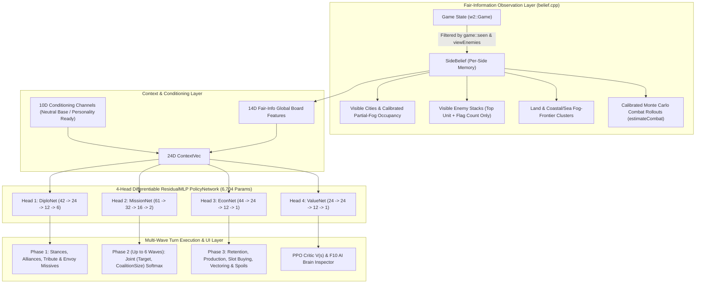

# Warlords II Remake — Tabula-Rasa Fair-Information RL AI & Upgraded Diplomacy Design (`AI-DESIGN.md`)

## 1. Executive Summary & Core Philosophy

The original 1993 *Warlords II* computer player (`SEG22` / `2e3c:*`, preserved in [`cpp/src/warlords/ai.cpp`](cpp/src/warlords/ai.cpp) behind `Side::classicAi = true`) relies on omniscient map lookups and rigid `if/then` decision trees:
- It scans `g.map->cities` and `g.armies` globally—ignoring `Hidden Map` fog-of-war (`g.explored`) and `View Enemies` stack-inspection restrictions.
- Its diplomacy (`ai_diplomacy`) uses fixed random dice rolls (`1d20 < 4`) with no persistent memory of betrayal, no alliances, no truces, no tribute, and no explanation to the human player.
- Its tactical movement (`ai_move_all`, `ai_pick_target`) dispatches stacks greedily within a fixed 14-tile bounding box (`|dx| < 14, |dy| < 14`) and evaluates battles via a static `strength * hits` sum that ignores terrain, city defense, hero leadership, flying/anti-air bonuses, and stack fight order.

This AI implementation replaces the 1993 expert system with a **Tabula-Rasa, Fair-Information Reinforcement Learning Architecture** and an **Upgraded Diplomacy & Communication System**, built around three foundational principles:

1. **Strict Human-Equivalent Information (Zero Map/Stack Cheating)**
   - Under `Hidden Map` (`hiddenMap != 0`), the AI only knows tiles revealed in `g.explored[side.index]` (plus tiles shared by `ALLIED` partners and sites/cities revealed by Sages or Quests) and is forbidden from A* pathfinding through unseen fog tiles in [`move::prepare`](cpp/src/warlords/move.cpp).
   - Under `View Enemies` off (`viewEnemies == 0`), the AI only observes a visible enemy stack's flag count (`1..8`, or `4` for unprobed Towers) and top army sprite (`armies[0]->type`). It maintains an explicit per-side belief memory ([`SideBelief`](cpp/src/warlords/ai/belief.hpp)) updated after real battles.
2. **Zero Strategic Heuristics & Zero Hand-Coded Priors (100% Emergent via RL)**
   - [`PolicyNetwork::initRandomWeights`](cpp/src/warlords/ai/ml_policy.cpp) initializes all weights from small zero-mean uniform noise—zero human-authored skip-connection priors, zero fake combat probabilities on non-combat targets, zero fabricated garrison threat floors, and zero C++ win-probability vetoes.
   - Rules code computes only honest, normalized physical observables in $[-1, 1]$ and executes legal moves. Every strategic behavior—neutral blitzes, multi-castle road chains, coastal sea embarkations, siege coalition sizing, frontline garrisoning, army production, slot buying, city vectoring, and diplomatic alliances—emerges dynamically from **Proximal Policy Optimization (`PPO`) + Generalized Advantage Estimation (`GAE`) + Hall-of-Fame Pure Self-Play** in [`w2arena`](cpp/test/arena.cpp).
3. **Personality-Ready Conditioning & Transparent Player Observability**
   - Ten reserved conditioning channels (`c[14..23]`) in [`ContextVec`](cpp/src/warlords/ai/ml_policy.hpp) alongside the 27 character card profiles ([`personality.hpp`](cpp/src/warlords/ai/personality.hpp)) support both neutral base-policy training and future RL-derived personality dispositions.
   - Human players can inspect *why* an AI faction holds its disposition via the **Parley & Attitude Ledger** ([`diplomacyui.cpp`](cpp/src/ui/diplomacyui.cpp)), receive throttled Turn-Start **Envoy Missives**, and press **`F10`** at any time to open the **AI Brain & Neural Policy Inspector**.

---

## 2. Architecture Overview



### Module Map

| File | Responsibility |
| :--- | :--- |
| [`cpp/src/warlords/ai/belief.hpp`](cpp/src/warlords/ai/belief.hpp), [`belief.cpp`](cpp/src/warlords/ai/belief.cpp) | Fair-information filter, land (`<= 48`) and coastal/sea (`<= 24`) fog-frontier clustering, true rival distance (`cityNearestEnemyDist`), battle observation memory, and calibrated partial-fog Monte Carlo combat estimator. |
| [`cpp/src/warlords/ai/ml_policy.hpp`](cpp/src/warlords/ai/ml_policy.hpp), [`ml_policy.cpp`](cpp/src/warlords/ai/ml_policy.cpp) | Pure C++20 `ResidualMLP` with analytical `forward` and `backward` passes, 4-head `PolicyNetwork` (`6,704` parameters), zero-prior `initRandomWeights`, multiplicity-balanced `selectFromLogits`, `computeEmpirePotential`, and JSON serialization ([`cpp/ai_weights.json`](cpp/ai_weights.json)). |
| [`cpp/src/warlords/ai/modern_ai.hpp`](cpp/src/warlords/ai/modern_ai.hpp), [`modern_ai.cpp`](cpp/src/warlords/ai/modern_ai.cpp) | Multi-wave turn engine (`playTurn`, `selectHeroCity`) scoring joint `(Target, CoalitionSize)` candidates, coastal/boat embarkation, dynamic fog-reveal wave yields, and unified economic choices, while recording `TurnStepRecord` trajectories when `RolloutSampler` is active. |
| [`cpp/src/warlords/ai/personality.hpp`](cpp/src/warlords/ai/personality.hpp), [`personality.cpp`](cpp/src/warlords/ai/personality.cpp) | Maps all 27 character cards (`K000–W008`) to metadata titles, archetypes, mottos, and 10D trait vectors for UI inspection and downstream personality conditioning. |
| [`cpp/src/warlords/diplomacy.hpp`](cpp/src/warlords/diplomacy.hpp), [`diplomacy.cpp`](cpp/src/warlords/diplomacy.cpp) | Mutual `ALLIED` shared-vision tier, 10/15-turn truce timers, gold tribute transfers, joint-war targets, relational trust, and `computeAttitude` ledger. |
| [`cpp/src/ui/diplomacyui.cpp`](cpp/src/ui/diplomacyui.cpp) | Upgraded Diplomacy Report/Action badges, interactive `ParleyModal` Attitude Ledger, Turn-Start `MissiveModal`, and `F10` `BrainInspectorModal`. |
| [`cpp/test/arena.cpp`](cpp/test/arena.cpp) | Multi-threaded Tabula-Rasa **PPO + GAE + Hall-of-Fame Pure Self-Play** trainer (`w2arena`) and read-only external benchmark suite against the 1993 Classic AI. |

---

## 3. Clean Fair-Information Sensors (`belief.cpp`)

1. **Fog-of-War Pathing Enforcement (`Hidden Map`)**
   - [`move::prepare`](cpp/src/warlords/move.cpp) enforces the exact same unseen-tile barrier (`UNSEEN` / `SHUT`) for modern AI sides (`!side->computer || !side->classicAi`) as for human players, while [`game::seen`](cpp/src/warlords/game.cpp) shares explored tiles across mutually `ALLIED` sides.
2. **Land & Coastal/Sea Fog Frontiers**
   - [`belief::update`](cpp/src/warlords/ai/belief.cpp) clusters seen passable land tiles and coastal `WATER`/`SHORE` tiles (`terrain != MOUNTAINS`) that border unseen tiles into separate land (`<= 48`) and sea (`<= 24`) `FrontierCluster` centroids (`isWater`, `onRoad`). Island-starting factions (such as Side 7 on `ERYTHEA` or archipelago factions on `ISLADIA`) naturally observe coastal sea frontiers and embark ships across unexplored oceans.
3. **Calibrated Partial-Visibility Combat Estimation (`estimateCombat`)**
   - Under `viewEnemies == 0`, [`belief::estimateCombat`](cpp/src/warlords/ai/belief.cpp) constructs synthetic defender stacks strictly from fair observations (visible stack flag count, top sprite `armies[0]->type`, and `observedStrengthRatio` learned from prior battles) and runs $N=16$ RNG-isolated [`combat::fight`](cpp/src/warlords/combat.cpp) rollouts.
   - For partially seen 2×2 cities (`seenTileFraction` $\in (0, 1]$): neutral garrisons in *Warlords II* strictly occupy `(city.x, city.y)` (`setupGarrisons`), so when `(city.x, city.y)` is visibly empty, `estimateCombat` fabricates **zero** phantom defenders; for unseen enemy city corners, occupancy is sampled proportionally to `(4 - seenTiles) / 4` inside the rollouts.
4. **Honest Rival Proximity (`cityNearestEnemyDist`)**
   - `cityNearestEnemyDist` measures distance strictly to visible non-allied rival cities and stacks—never conflating passive neutral cities or unexplored fog borders with active enemy armies.

---

## 4. 4-Head Differentiable Policy & Value Network (`ml_policy.cpp`)

Each head in [`PolicyNetwork`](cpp/src/warlords/ai/ml_policy.hpp) is a 2-hidden-layer `ResidualMLP` with $\tanh$ activations, a direct linear skip matrix $\mathbf{W}_{\text{skip}}$, and exact analytical backpropagation (`ResidualMLP::backward`), totaling **6,704 float32 parameters**:

$$\mathbf{h}_1 = \tanh(\mathbf{W}_1 \mathbf{x} + \mathbf{b}_1), \quad \mathbf{h}_2 = \tanh(\mathbf{W}_2 \mathbf{h}_1 + \mathbf{b}_2), \quad \mathbf{y} = \mathbf{W}_{\text{skip}} \mathbf{x} + \mathbf{W}_3 \mathbf{h}_2 + \mathbf{b}_3$$

### Shared 24D Fair-Information Context (`buildContext`)
- **14D Global Observables (`c[0..13]`)**: turn progress, our share of *visible* cities, normalized mobile army count (`tanh(myArmies / 24)`), treasury (`tanh(gold / 300)`), net gold flow (`tanh((income - upkeep) / 40)`), visible neutral city count (`tanh(visNeutrals / 6)`), visible enemy city count (`tanh(visEnemyCities / 6)`), active war/alliance ratios, largest visible rival city share, `frontierRatio`, immediate capital threat, active quest flag, and hero count.
- **10D Conditioning Channels (`c[14..23]`)**: held at `0.0` during base tabula-rasa training so all factions share a clean, unfragmented representation before personality derivation.

### The 4 Neural Heads

| Head | Dimensions | Input Composition | Output | Role |
| :--- | :--- | :--- | :--- | :--- |
| **`DiploNet`** | `42 -> 24 -> 12 -> 6` (`1,650` params) | `24D Context` + `18D RivalVec` (stance one-hot, truce, trust, border threat, relative strength/cities, shared war) | `4` stance logits (`Ally`, `Peace`, `Uneasy`, `War`), `tributeSignal`, `jointWarSignal` | Scores diplomatic proposals, alliances, tribute, and joint wars. |
| **`MissionNet`** | `61 -> 32 -> 16 -> 2` (`2,674` params) | `24D Context` + `16D StackVec` (size, strength, speed, hero/flier/siege flags, speed drop, **origin-city remaining guard `s[14]`**, **origin-city threat `s[15]`**) + `21D TargetVec` (8-way `TargetKind` one-hot, unclipped `72`-MP reachability `1/(1+turns)`, `reachableNow`, honest `winNow`/`winConverged`/`survRatio`, value, threat, friendly convergence, **`requiresBoatEmbark` `t[19]`**, **`seenTileFraction` `t[20]`**) | `(utility, stageNearLogit)` | Jointly scores `(Target, CoalitionSize)` candidates in a single listwise softmax plus binary `StageNear` vs `AttackNow`. |
| **`EconNet`** | `44 -> 24 -> 12 -> 1` (`1,429` params) | `24D Context` + `20D EconVec` (`HoldGold`, `ProduceSlot`, `StopProd`, `BuySlot`, `VectorCity`, `RetainArmy`, `CaptureSpoils`, unit stats, cost, city threat/distance, garrison count) | `actionScore` | Scores army retention, unit production, slot purchases, vectoring, and capture spoils (`Occupy`/`Pillage`/`Sack`/`Raze`). |
| **`ValueNet`** | `24 -> 24 -> 12 -> 1` (`951` params) | `24D Context` | $V(s) = \tanh(y) \in [-1, 1]$ | Predicts expected empire return for PPO Generalized Advantage Estimation (`GAE`) and the `F10` Brain Inspector. |

---

## 5. Multi-Wave Execution & Tabula-Rasa PPO Self-Play (`modern_ai.cpp`, `arena.cpp`)

### Clean Multi-Wave Actuator (`modern_ai.cpp`)
- **Joint `(Target, CoalitionSize)` Listwise Selection**: At each stack location, candidate coalition sizes (`{1, 2, 4, N-1, N, fastPrefix}`) and reachable targets (`HOLD_GARRISON`, `REINFORCE_CITY`, `NEUTRAL_CITY`, `ENEMY_CITY`, `ENEMY_STACK`, `RUIN_OR_SAGE`, `TEMPLE_OR_ITEM`, and the closest local land/sea `FOG_FRONTIER`s) are evaluated jointly in one listwise softmax—allowing the policy to split fast scouts onto lightly defended castles, leave a 1-unit garrison behind in threatened frontline cities (`N - 1`), or assemble 4–8 unit siege stacks against fortified capitals.
- **Zero Actuator Vetoes & Multi-Wave Continuation**: When `MissionNet` selects an attack (`!stageNear`), [`executeStackMission`](cpp/src/warlords/ai/modern_ai.cpp) always executes it (gathering co-located friendly stacks on the launching tile). Stacks that win a battle or reveal new fog tiles (`seenBoxAfter > seenBoxBefore`) with `>= 2` movement points remaining yield back to the outer wave loop (`up to 6 waves/turn`), enabling road-blitz castle chains and immediate same-turn pivots onto newly uncovered castles.

### Pure Self-Play PPO + Multiplicity-Balanced Softmax (`arena.cpp`)
1. **Pure Self-Play League**: All 8 active sides in training rollouts are played by `PolicyNetwork` instances (`2/3` pure mirror self-play, `1/3` against a rotating Hall-of-Fame archive across `ERYTHEA`, `ISLADIA`, `DRAGON`, `TUTORIA`, `SORCERY`, `HADESHA` and 4 fog/diplomacy presets). The 1993 Classic AI is **never** used in training—only as a read-only external ruler.
2. **Policy-Invariant Potential Shaping & Causal Intra-Turn Credit**:
   - Step rewards combine terminal victory/elimination outcomes with telescoped potential shaping $r_t = \gamma \Phi(s_{t+1}) - \Phi(s_t)$ (`GAMMA = 0.96`, `GAE_LAMBDA = 0.92`), where [`computeEmpirePotential`](cpp/src/warlords/ai/ml_policy.cpp) measures owned city share, income share, mobile army strength, and monotonic hidden-map reconnaissance progress.
   - Multi-stack `MissionStepRecord`s use a counterfactual per-turn baseline plus geometric intra-turn return-to-go (`0.5` decay across subsequent waves) so Wave 1 scouts receive direct credit when Wave 2 captures a castle they just revealed.
3. **Action-Multiplicity Softmax Normalization (`-log(N_family)`)**:
   - Because a stack may face 20+ `FOG_FRONTIER` options alongside a single `HOLD_GARRISON` option (or 4 `ProduceSlot` options alongside 1 `StopProd`), naive flat softmax sampling dilutes individual fog/production logits by $-\ln N_{\text{family}}$, causing deterministic test-time `argmax` to pick a low-probability `Hold` action over a 95%-total-mass `Explore` family.
   - Adjusting sampling logits by $z_i = u_i / T - \ln N_{g(i)}$ paired with a KL-to-family-uniform regularizer gives every available action family exact $1 / K_{\text{families}}$ prior mass at Iteration 0 and guarantees strict alignment between stochastic rollouts and deterministic `argmax` execution.

---

## 6. Emergent Tabula-Rasa Results & Multi-Preset Benchmarks

Starting from **100% random zero-mean weights (`--from-scratch`)** in [`w2arena`](cpp/test/arena.cpp) (`80` iterations $\times$ `16` 8-player games/iteration, `16` threads):

| Iteration | Self-Play `AvgCities/Side` | Self-Play `NeutralsLeft` | External Eval `Cities@T10` (Learner vs Classic) | External Eval `Cities@End` | Match Wins vs Omniscient Classic AI |
| :---: | :---: | :---: | :---: | :---: | :---: |
| **Iter 0 (Random Noise)** | `1.96` | `35.7` | `30` vs `275` | `16` vs `471` (`3.3%`) | `0 / 8` |
| **Iter 20** | `2.66` | `30.9` | `160` vs `273` | `148` vs `425` (`25.8%`) | `1 / 8` |
| **Iter 40** | `6.12` | `17.2` | `160` vs `242` | `147` vs `419` (`26.0%`) | `1 / 8` |
| **Iter 60** | `6.91` | `9.6` | `163` vs `265` | `196` vs `368` (`34.8%`) | `3 / 8` |
| **Iter 70** | **`8.09`** | `9.8` | **`189` vs `234`** | **`190` vs `359` (`34.6%`)** | **`4 / 8` (`50%`)** |
| **Iter 80** | `7.79` | **`7.3`** | `188` vs `232` | `173` vs `389` (`30.8%`) | `1 / 8` |

### 8-Faction Conquest Benchmark (`Turn 25`, Before Fix vs Tabula-Rasa RL vs 1993 Classic AI)

| Scenario & Preset | Old Prior-Based Modern AI | **Tabula-Rasa RL Modern AI (Fair Info)** | 1993 Classic AI (Omniscient Map/Stack Cheat) |
| :--- | :--- | :--- | :--- |
| **`ERYTHEA` Beginner** (`OpenMap`, `NoDiplo`, Weak Neutrals) | `30` captures (`59` neutrals left; `S7=1`) | **`438` captures** (`8` neutrals left; Island `S7=18` cities) | `143` captures (`0` neutrals left; `S7=14` cities) |
| **`ERYTHEA` Intermediate** (`OpenMap`, `Diplo=1`, Avg Neutrals) | `29` captures (`60` neutrals left; `S7=1`) | **`289` captures** (`5` neutrals left; Island **`S7=20` cities**) | `102` captures (`0` neutrals left; `S7=12` cities) |
| **`ERYTHEA` Advanced** (`HiddenMap=1`, `ViewEnemies=0`, Strong Neutrals) | `14` captures (`66` neutrals left) | **`97` captures** (`46` neutral + `51` enemy captures) | `95` captures (`66` neutral + `29` enemy — *cheats fog!*) |
| **`ISLADIA` Archipelago** (`HiddenMap=1`, `ViewEnemies=0`, Maritime) | Stalled on home islands | **`116` captures** (`55` neutral + `61` enemy; Island `S7=9` cities) | `84` captures (`70` neutral + `14` enemy — *cheats fog!*) |

---

## 7. CLI & Training Reference

```bash
# Build all targets with Ninja (Release):
cmake -G Ninja -B cpp/build -S cpp -DCMAKE_BUILD_TYPE=Release
cmake --build cpp/build

# Run full unit & regression test suite:
./cpp/build/w2test

# Train from 100% Tabula Rasa random weights via multi-threaded PPO Pure Self-Play:
./cpp/build/w2arena --from-scratch --iterations 80 --games-per-iter 16 --turns 25 --eval-every 10 --out cpp/ai_weights.json

# Run read-only external benchmark suite against the 1993 Classic AI:
./cpp/build/w2arena --benchmark-only --turns 25 --out cpp/ai_weights.json

# Default launch: Modern RL AI + Classic 1993 UI (AI mode is also toggleable via Game > Modern AI / Classic AI):
./cpp/build/warlords2 --window --scenario ERYTHEA --diplomacy --hidden-map

# Opt into the overhauled Parley / Diplomacy / Envoy Missive / F10 Brain Inspector UI:
./cpp/build/warlords2 --window --modern-ui --scenario ERYTHEA --diplomacy --hidden-map

# Force the original 1993 Classic AI from the command line:
./cpp/build/warlords2 --window --classic-ai --scenario ERYTHEA --diplomacy --hidden-map

# Watch an 8-AI battle royale with full-map spectator visibility (each AI still obeys Hidden Map fog!):
./cpp/build/warlords2 --window --modern-ui --scenario ERYTHEA --diplomacy --hidden-map --spectate
```
