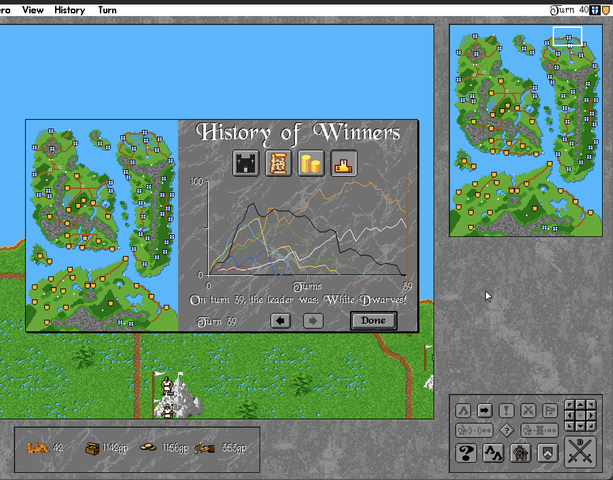
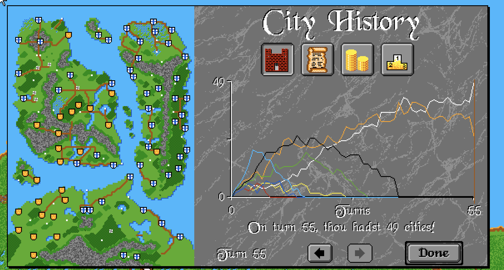
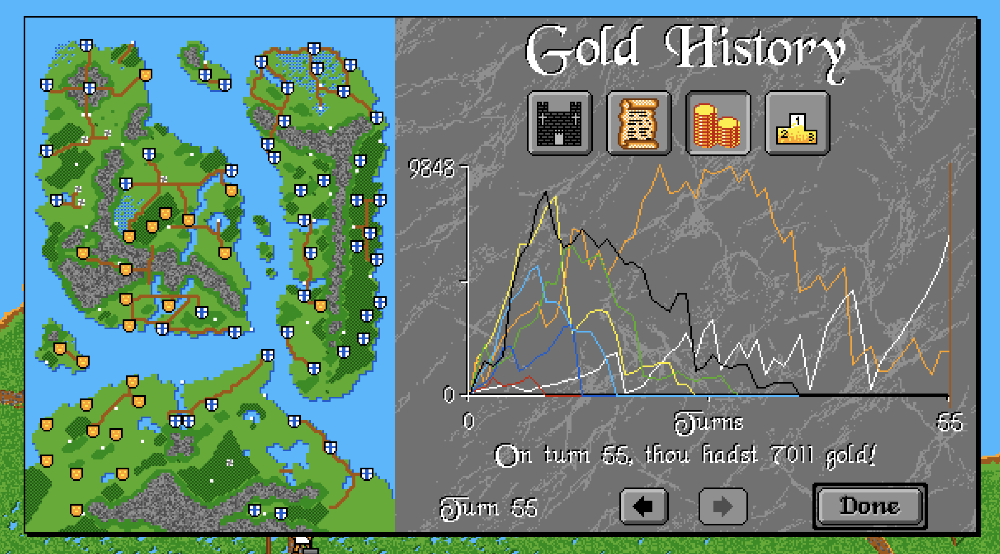
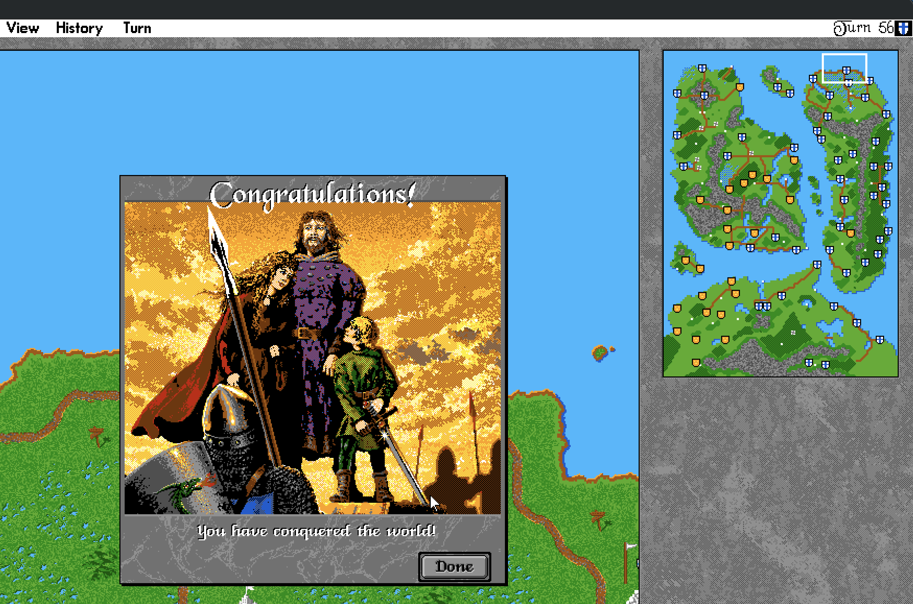

# Modern AI: design, training, and how to continue (`AI-DESIGN.md`)

This document is the handoff for the learnable "Modern AI" on the `ai` branch:
what it is, how it is trained and measured, what has been learned so far, and
exactly how to continue training on a larger machine.

> [!IMPORTANT]
> **Status (2026-11-08).** The installed checkpoint (`cpp/ai_weights.json`, v7,
> `9,886` core parameters + `130`-parameter `Commander` posture projection)
> comes from the 4-track improvement tournament (§6.4): paired-seed antithetic
> Evolution Strategies (`w2evolve`) with mid-game snapshot forking, `v7`
> cross-turn Order Memory, Field-Stack Rallying, public game-mode context
> (`diplomacy`, `hiddenMap`, `neutralCities`, map scale), and trajectory
> step-size damping (`damped_v7_soup`). Across `768` paired games (`512` dev +
> `256` held-out report), it improves over the `v6` curriculum checkpoint by
> **`+1.22 % ± 1.99 %`** at Turn 40 (`48.5 %` on `512` dev, `44.9 %` on `256`
> report; **4 / 4 presets up on dev**) and **`+2.04 % ± 2.41 %`** at Turn 60
> (`47.4 %` on `512` dev, **4 / 4 presets and 6 / 6 scenarios up**), while
> holding parity against garrisoning Wardens (`142W / 124L`). Adding fair
> online portfolio lookahead (`w2search portfolio`, `Judge::Fair`) pushes
> Modern **above 50 % parity (`50.8 % ± 5.8 %`)** against the 1993 Classic AI.

---

## 1. What the Modern AI is

Two computer players coexist, selected per side by `Side::classicAi`:

| | Classic AI | Modern AI |
|---|---|---|
| Code | `cpp/src/warlords/ai.cpp` and `ai/{cities,groups,moves,heroes,diplomacy}.cpp` | `cpp/src/warlords/ai/modern_ai.cpp`, `ml_policy.cpp`, `belief.cpp` |
| Origin | Reverse-engineered 1993 expert system (faithful to original DOS WARLORD2.EXE) | Learned policy (PPO self-play & `1 vs K−1` Classic curriculum) |
| Information | Reads the whole map (ignores Hidden Map for itself) | Fair information: sees only what a human would (§3) |
| Selected by | `--classic-ai`, Game › Classic AI | default; `--modern-ai`, Game › Modern AI |

The game also has an optional modern UI (`--modern-ui`: Parley, envoy
missives, F10 AI Brain inspector). It is independent of which AI plays.

## 2. How a Modern AI turn works

`modern::playTurn` (`modern_ai.cpp`) runs:

1. **Belief update** (`belief::update`): visible cities, sites and items, observed
   enemy stacks, threat maps, border strengths and fog frontiers.
2. **Diplomacy** (whenever Diplomacy is on, once per encountered rival per turn,
   including rivals newly revealed mid-turn by scouting). For each known rival,
   DiploNet picks a stance (Ally / Peace / Uneasy / War) plus two yes/no
   sub-decisions: offer gold to end a war, and ask a friend to join our war.
3. **Military waves** (up to 6). For each group of the side's armies sharing a
   location, rules code lists every legal **target**: hold garrison, reinforce an
   own city, neutral city, enemy city, enemy stack, ruin/sage, temple/item, fog
   frontier. Each target (including `HOLD_GARRISON`) is combined with candidate
   **coalition sizes** (1, 2, 4, N−1, N, fast prefix). MissionNet scores every
   (target, size) pair with zero tactical `if-then-else` filtering. One is sampled
   from a softmax, plus a yes/no "stage nearby first" for attacks, and executed
   with the normal movement and combat rules. Stacks that win or reveal fog with
   moves left go again in the next wave.
4. **Economy**. EconNet scores, as separate categorical choices:
   - keep vs disband (`e[5] = 1`, only offered when upkeep exceeds income);
   - up to 3 empire-wide production-slot purchase rounds per turn (`e[3] = 1`,
     including slot fullness `e[16]`, strength upgrade delta `e[17]`, and legal
     slot-0 replacement in full 4-slot cities), stopping as soon as EconNet picks
     `HoldGold` (`e[0] = 1`);
   - per city, macro-action production (`Stop` vs each production slot via
     `game::setProduction`), queried whenever a city is idle or has just finished
     a unit (`c->countdown == slot.time`) so multi-turn elite builds are never
     cancelled mid-countdown;
   - per city, the vectoring destination;
   - after a capture: occupy / pillage / sack / raze.

**Rules, not learned:** legal candidate generation, pathing, combat estimation,
the hero-arrival city (most threatened own city), and the treaty rule (an attack
needing a declaration happens only while DiploNet is not proposing peace to that
side; `attackable()` / `mustDeclare`).

**Sampling in real games.** Real games sample the policy at
`DEPLOY_TEMPERATURE` = 0.02 (`ml::deployTemperature()`), i.e. near-greedy. The
generator is seeded from the game's dice state, the turn and the side, and
never advances the game's RNG, so games stay reproducible. Training still
anneals to `TRAIN_TEMPERATURE_END` = 0.5, because PPO needs exploration. A
sweep with the installed weights (512 dev games each, turn 40) was monotonic:
T = 0.5 → 35.9 %, 0.25 → 38.2 %, 0.15 → 39.7 %, 0.08 → 42.4 %, 0.02 → 43.4 %
city share; on the held-out report set 32.1 % → 40.9 % (§6). (An earlier
observation that greedy play was worse was made with the much weaker handoff
checkpoint.)

### The network (`ml_policy.hpp`)
Five residual MLPs, `y = W_skip·x + W3·tanh(W2·tanh(W1·x + b1) + b2) + b3`,
**10,097 parameters** in `v8` (`9,886` in `v7`, plus an optional `130`-parameter
`Commander` projection, optional `669`-parameter `MusterNet`, and optional
`454`-parameter `GateNet`), with hand-written forward and backward passes
(no ML library):

| Head | Input | Output |
|---|---|---|
| DiploNet 48→24→12→6 | context 30 + rival 18 | 4 stance logits, tribute logit, joint-war logit |
| MissionNet 75→32→16→2 | context 30 + stack 16 + target 29 | utility, stage-near logit |
| EconNet 56→24→12→1 | context 30 + econ 26 | score (disjoint `[0..6]` selects decision type; `[20]` flags current choice; `[23..25]` `v8` Muster Hub) |
| ValueNet 46→24→12→1 | context 30 + critic 16 | V(s), empire-level critic in empire-score units |
| StackValueNet 62→24→12→1 | context 30 + stack 16 + critic 16 | V_stack(s), pre-decision pool critic for multi-turn per-stack local returns |
| MusterNet 44→12→6→1 *(optional `v8`)* | context 30 + city 14 | score for selecting `0..2` Empire Meeting Points (`"muster"` in JSON) |

**Privileged critics (asymmetric actor-critic).** The two critics are only used
to compute training advantages, so they also read 16 true-state features
(`buildCriticFeatures`: true city/income/army shares, strongest rival, neutrals,
map size, sides alive/in use, Hidden Map and Diplomacy flags, share of Classic
rivals, threatened own cities, empire score, an unsaturated turn counter). The
policy heads never see them. This raised the critic's explained variance from
~0.56 to ~0.70 (logged as `ev` per iteration).

Context is 20 global fair-information features (`c[0..19]`), plus in `v7` five
public lobby/map-scale context features (`c[20..24]`: Total War `diplomacy == 0`,
`hiddenMap != 0`, weak 1-strength Scout neutrals `neutralCities <= 0`, active
strong neutrals `neutralCities >= 2`, and active map area ratio) and five empire
posture channels (`c[25..29]`, computed by the learned `Commander` projection
when `"commander"` is present in JSON). Target features `t[21..24]` carry `v7`
cross-turn **Order Memory** persisted in `Army::aiOrder/aiDest/aiGroup` (share of
coalition already marching on this target, whether staged outside it last turn,
turns committed, and total allied strength en route), and `v7` adds **Field-Stack
Rally** targets onto friendly field hero or staged siege stacks (`< 8` units) so
reinforcements merge in the field.

**Multiplicity prior.** Option families have very different sizes (40 fog
frontiers vs 1 hold). The policy logit at temperature `T` is therefore
`z_i = u_i / T − ln N_family(i)`, sampled via `softmax(z)`. Subtracting
`ln N_family(i)` *outside* `1/T` ensures every equal-utility family receives equal
probability mass at any temperature (fixing an earlier `(u_i − ln N)/T` bug that
penalised multi-option families by `1/N²` at `T = 0.5`). A KL pull toward the
uniform-family prior `q_i ∝ 1 / N_family(i)` is the entropy regulariser.

Weights live in `cpp/ai_weights.json` (`v7` champion `damped_v7_soup`, `9,886`
parameters + `130` `commander` parameters, loaded function-preservingly into the
`10,097`-parameter `v8` engine). Version 7 (`9,886`), 6 (`9,700`), 5 (`8,866`),
4 (`8,066`) and 3 (`6,729`) files all load function-preserving (`unflattenLegacy`):
input columns an older format lacked start at zero, so any migrated network plays
identically until training uses the new inputs.

## 3. Fair-information rules
- Pathing obeys Hidden Map for Modern AI sides exactly as for humans
  (`move::prepare`).
- Enemy stacks: only flag count and top unit, unless View Enemies is on. Fuller
  knowledge comes only from battles fought (`recordBattleObservation`).
- Combat estimates (`estimateCombat`) build defenders from those observations
  and run 8 simulated battles with the game's RNG saved and restored.
- The attitude score fed to DiploNet counts only visible cities.
- Known remaining public-knowledge assumptions: capital identity, diplomatic
  scores (shown in the diplomatic report), and neutral garrisons standing on a
  city's top-left tile.
- The empire score (§4) reads the true state, but only as a training reward,
  never as a policy input.

## 4. Training objective (`cpp/test/arena.cpp`)

**Empire score** (`computeEmpireScore`, `ml_policy.cpp`):

    S = 2·cityShare + 0.5·incomeShare + 0.25·armyShare (+ ≤0.15 recon under Hidden Map),  S = 0 when eliminated

Shares are of all standing cities, total income, and Lanchester `strength²`
across all sides' armies (including vectored units in `transit`), with `recon`
measured over the active map box (`activeX0..activeX1 × activeY0..activeY1`).
S is the **one deliberate prior**: a hand-chosen definition of "doing well".

**Reward** for a side's turn t is `S(start of its next turn) − S(start of turn t)`,
so losses during rivals' turns count. A win adds +1 and elimination −0.5.
Training games stop after `--turns`. That cut-off is a time limit, not the end
of the game, so the critic bootstraps there. The objective is therefore the
discounted growth of S with no fixed horizon (γ = 0.97, so about 33 turns
ahead).

## 5. Trainer, small-to-large curriculum, and evaluation

**PPO.** Each iteration:
1. Play `--games-per-iter` games in parallel (one thread per game). Two opponent
   modes are supported:
   - **`--solo-learner` (`1 vs K − 1` Classic AI):** exactly 1 active seat
     (rotated uniformly via `seed % K`) is the recorded Modern AI learner; all
     `K − 1` remaining active seats run the 1993 Classic AI (`level = 2`,
     Warlord). Combined with `--active-sides K --crop-margin M --random-map-frac F`,
     this supports a small-to-large curriculum (`1v1` cropped maps → `1v3`
     cropped maps → `1v7` full 8-side scenarios, plus thread-safe in-memory
     random maps via `scn::loadFromFiles`).
   - **Self-play / league (`--classic-frac F`):** half mirror matches, half
     hall-of-fame league matches, with fraction `F` against the Classic AI.
2. Compute GAE per side (λ = `--lambda`, default 0.95). Mission decisions get the
   turn's advantage plus `--local-weight` × `(G_pool − V_stack(s))`, where
   `G_pool` sums multi-turn (`γ_stack = 0.90`) immediate score changes over the
   pre-decision group's permanent `Game::pool` `Army*` addresses (`uintptr_t`,
   avoiding recycled `Army::slot` aliasing when units die). Early curriculum
   stages (`1v1`, `1v3`) use `--local-weight 1.5–2.0` for sharp per-stack
   offensive credit; full 8-side `1v7` polishing uses `--local-weight 0.0` so
   rival-turn counter-captures are weighted cleanly via empire-score GAE.
3. Normalise advantages per head, then run 4 epochs × 8 minibatches of turns.
   Each head's loss is a mean over its own decisions; `ValueNet` and
   `StackValueNet` MSE losses each carry weight 0.5. Gradients are clipped to a
   global norm of 0.5. Adam decays linearly from `--lr` to `3e-4`. Epochs stop
   early if the approximate KL exceeds 0.03.
4. Temperature anneals `--temp-start` (default 1.0) → 0.5 (`DEPLOY_TEMPERATURE`).

**Evaluation (never used for training).** Mixed 4-vs-4 games on full maps (or
`1 vs K − 1` during cropped-map selection when `--solo-learner` is set), Modern
vs Classic, cut off at `--eval-turns`. On full maps each seed is played twice
with the side assignment swapped. There are two disjoint seed sets, both
disjoint from training seeds (`< 700000`, shifted per stage via `--seed-offset`):
- **selection** (`--select-seeds`, base 700000): every `--eval-every`
  iterations. The best score is saved to `--out`.
- **report** (`--report-seeds`, base 800000): kept at `0` throughout training
  and model selection, and measured on the final checkpoint (`--benchmark-only`).

Scenarios and presets rotate over ERYTHEA, ISLADIA, DRAGON, TUTORIA, SORCERY
and HADESHA, × {Beginner-Open, Interm-Diplo, Adv-Hidden, Fog-TotalWar}.

## 6. Results

### 6.1 Handoff baseline (16-core Mac, 32 games/iter, `d443982`)

| Run | Setup | Selection city share (iterations 10…100) | Best |
|---|---|---|---|
| A | pure self-play | 9, 8, 11, 18, 14, 9 % … (stopped at 68) | 18.2 % @40 |
| B | `--classic-frac 0.3` | 3, 12, 17, 12, 10, 14, 13, 14 % … | 16.5 % @30 |
| C | B + `--local-weight 5 --lambda 0.9` | 9, 15, 14, 10, 12 % … (stopped at 58) | 15.1 % @20 |
| B report | kept checkpoint (iter 30), 48 held-out games | **19.8 % ± 8.4 %** mean share; 305 vs 2,024 cities (13.1 %); Modern largest side in 5/48 | previous `cpp/ai_weights.json` |

### 6.2 Pure-discovery `1 vs (K − 1)` curriculum on 72-thread Linux (`2026-11-06`)

Trained with **zero hand-coded tactical/economic/diplomatic `if-then-else`
filters** (`--report-seeds 0` throughout curriculum tuning; `pure_s4_1v7` was
checked once on 128 report games before discovering the `midCountdown` and
`HOLD_GARRISON` representation bugs, and the final checkpoint
`pure_s6_1v7_unlocked` was selected strictly on 192 selection games before its
one-time held-out report evaluation; both are reported below for transparency):

| Benchmark Split (Turn 40, all 6 scenarios × 4 presets) | Handoff (`d443982`) | Stage 4 (`pure_s4_1v7`) | **Installed (`pure_s6_1v7_unlocked`)** |
|---|---|---|---|
| **192-game canonical selection** (`--select-seeds 96`, `700000+`) | 16.1 % ± 3.7 % (`975` vs `8,202`; #1 in `18/192`) | 30.1 % ± 4.4 % (`2,227` vs `7,188`; #1 in `33/192`) | **35.3 % ± 4.8 %** (`2,601` vs `6,800`; **#1 in `50/192`**) |
| **48-game held-out report** (`--report-seeds 24`, `800000+`) | 19.8 % ± 8.4 % (`305` vs `2,024`; #1 in `5/48`) | 25.2 % ± 8.7 % (`484` vs `1,854`) | **32.9 % ± 9.4 %** (`628` vs `1,732`; **#1 in `12/48`**) |
| **128-game held-out report** (`--report-seeds 64`, `800000+`) | **18.4 % ± 4.9 %** (`[13.5, 23.3] %`; `743` vs `5,720`; #1 in `13/128`) | 27.7 % ± 5.2 % (`[22.5, 32.9] %`; `1,482` vs `5,006`; #1 in `19/128`) | **32.8 % ± 5.6 %** (`[27.2, 38.4] %`; **`1,710` vs `4,793`**; **#1 in `30/128`**) |
| **256-game extended held-out report** (`--report-seeds 128`, `800000..800127`) | **15.5 % ± 3.2 %** (`[12.3, 18.7] %`; `1,266` vs `11,124`; #1 in `22/256`) | — | **32.1 % ± 4.0 %** (`[28.1, 36.1] %`; **`3,271` vs `9,423`**; **#1 in `55/256`**) |

**Curriculum & ablation highlights:**
- **Small/medium maps:** On cropped `1v1` maps (`K = 2, crop = 14`, 64 games),
  tabula-rasa training (`causal_s1_1v1`, 60 × 288 games, 6 minutes) reached
  **45.7 % ± 11.0 %** mean share and tied Classic AI at **377 vs 377 aggregate
  cities (50.0 %)**. On `2v2` (`K = 4, crop = 14`), `causal_s2_1v3` reached
  **31.5 % ± 8.5 %** (largest side in `19/64`). On smaller shipped scenarios
  (`SORCERY` 20 cities, `DRAGON` 40 cities), Modern AI holds **54–87 %** of
  cities.
- **Why `4×` wider MLPs (`36,526` params, `128→64` / `96→48`) underperformed `8,066` params (`26.9 %` vs `42.0 %` on `1v1`):**
  1. Coordinate-wise Adam without $\mu$P width scaling (`1/width` hidden/output
     LR) produced `4×` larger `W3·h2` logit jumps, collapsing entropy (`0.86 → 0.48`
     vs `0.66`) into premature habits.
  2. `16×` larger `tanh` matrices plus global L2 gradient clipping (`0.5` across
     all `36.5k` params) drowned out the `122`-parameter linear `wSkip` skip
     connection that learns clean fundamentals first in the `8k` model.
  3. `ValueNet` (`3,745` params on 14 active context features) overfit current-batch
     returns (`vloss ≈ 0.02`), adding variance to GAE TD residuals, while
     unbatched scalar C++ backprop over ~30 candidates/decision ran `4×` slower.
- **Diagnostics (`w2aidiag` on held-out `ERYTHEA 800001`, 80 cities, Turn 40):**
  - Instead of the handoff checkpoint's defensive shuttling (`1,004` `Reinforce`
    vs `144` `Siege`), Modern AI executes `1,118` `Siege`, `641` `Intercept`,
    `300` `CaptureNeutral`, and `152` `Bless` moves against `451` `Reinforce`.
  - Without unit-preference rules, `EconNet` buys and produces a combined-arms
    mix (`Archers` 129, `Dwarves` 67, `Heavy Inf.` 53, `Orcish Mob` 30, `Giants`
    23, `Heavy Cav.` 23, `Pegasi` 20, `Griffins` 18, `Light Cav.` 18, `Catapults`
    13, `Minotaurs` 10). On `ERYTHEA 800001`, `side 0 MODERN` leads the entire
    80-city map at Turn 30 (`31` cities, `135` armies, `31` garrisoned in-city)
    and finishes Turn 40 alive with `21` cities and `368` strength.
  - **Remaining gap vs Classic AI on 80-city 8-player maps:** (1) Classic AI
    ignores *Hidden Map* (active in 50 % of benchmark presets) while Modern AI
    explores fog fairly; (2) in Turns 25–40 on 80-city continents, multi-front
    Classic coalitions still erode Modern AI's outer cities (~`95 %` of Modern
    army-turns move rather than garrisoning rear hubs).

### 6.3 Discoveries of 2026-11-06 (afternoon session)

All numbers are Modern city share in mixed 4 vs 4 games against the Warlord
Classic AI at turn 40 (50 % = parity), on the **development seed set** (750000+,
`--dev-seeds`, never used for selection or the report) unless marked *report*.
"Paired" means both checkpoints played the same seeds (`--compare`); with 512
games its 95 % interval is about ± 2.8 %, so smaller effects are not resolvable.

**Measurement.**
- The benchmark is deterministic: re-running a checkpoint reproduces it exactly.
- The selection eval used to keep the best of ~10 noisy (± 6.5 %) measurements,
  which inflates the kept score (winner's curse). Compare finals or snapshots
  with `--compare` on dev seeds instead.
- Diplomacy, not Hidden Map, splits the presets: installed weights at T = 0.5
  scored Beginner-Open (no fog, no diplomacy) 27.7 %, Interm-Diplo 55.2 %,
  Adv-Hidden 31.9 %, Fog-TotalWar 28.9 %. Total war is the weak spot.
- Solo 1 vs 7 (the training setup) on 8-player maps: 3–5 % vs 12.5 % parity.

**Deployment temperature — the one big win.** Same weights, 512 dev games each:

| T | 0.5 | 0.25 | 0.15 | 0.08 | 0.02 |
|---|---|---|---|---|---|
| city share | 35.9 % | 38.2 % | 39.7 % | 42.4 % | **43.4 %** |

Held-out *report* (256 games): 32.1 % at T = 0.5 → **40.9 %** at T = 0.02. Every
preset improves (Interm-Diplo reaches 61.6 %). Training still samples at 0.7 → 0.5.

**Critic.** Privileged true-state critic inputs raised explained variance from
~0.56 to ~0.70, but did not by themselves make the policy measurably stronger.

**Recipe variants, all warm-started from the installed weights** (48–64
iterations × 432 games, paired vs installed at T = 0.02):

| Run | Change | Paired B − A |
|---|---|---|
| E1 | privileged critic, s6 recipe | +1.3 % ± 2.9 % |
| E2 | learning rate 5e-3 (2.8×) | −0.7 % ± 2.9 % |
| E3 | 50 % of games 4 vs 4, all learner seats recorded | +1.0 % ± 2.7 % |
| E4 | training temperature 0.25 → 0.15 | −1.3 % ± 2.5 % |
| E5 | 60-turn games (judged at turn 60) | −0.8 % ± 3.0 % |
| E6 | 50 % of Classic seats are Raiders, 64 iterations | −0.8 % ± 2.9 % |
| E9 | departure credit (weight 2) + all games 4 vs 4 (shared live policy) | **−3.2 % ± 2.7 %** (significantly worse) |
| E10 | 1 vs 7, half the opponents the frozen installed AI, departure credit | −2.0 % ± 2.9 % |
| E11 | search as teacher (K=4, R=2, H=2, peeking teacher) | **−4.6 % ± 3.0 %** final; −1.0 % best |
| soups | weight average of E1–E3 checkpoints | −0.6 % / +1.0 % |

KL per iteration stays ~0.001–0.002 whatever the learning rate: the recipe sits
on a plateau rather than being step-size-limited.

**Hand-rule probes (diagnostics only, never part of the Modern AI)** all made it
*weaker*, which says the learned behaviour is a coherent strategy, not a set of
separable bugs: "always build + buy the strongest slot when ≥ 1,500 gold"
(31.3 % vs 35.9 % at T = 0.5; 39.0 % vs 43.4 % greedy), "≥ 1 / ≥ 2 garrison per
city" (32.6 % / 30.9 % vs 35.9 %), "leave the weakest unit behind" (39.9 % vs
43.4 % greedy). The economy *looks* broken (1–2 slot purchases per 40-turn game,
a third of city-turns idle, up to 18k gold banked) but is not the binding
constraint.

**Why it fades: empty cities.** Strength by game length (installed, greedy):
turn 20 **51.3 %**, turn 40 ~43 %, turn 60 40.9 %, turn 80 39.3 %
(Fog-TotalWar 41.5 → 26.6 → 23.8 %). `w2aidiag` capture/loss tracking over 12
total-war games: the Modern camp loses **~300 cities per game, ~88 % with zero
defenders**, and recaptures a similar number (much of it Modern-vs-Modern
ping-pong over empty cities); the Classic camp loses ~90, ~70 % of them defended
by 2+ armies. The policy already *sees* that a move empties its city (stack input
`s[14]`), but the loss arrives during a rival's turn and is shared by the ~70
moves of that turn, so the move that caused it learns almost nothing.

**Opponents instead of rules.** The Modern AI must discover its own strategy, so
pressure comes from training opponents (`cpp/test/opponents.cpp`). The
**Raider** plays the Classic AI but first walks its weakest armies into every
reachable undefended enemy city, the learner's first. Raiders take 30–40 more
cities per game than plain Classic sides; the installed AI scores 41.1 % against
them. Training with 50 % Raider seats alone (E6) did not help (table above):
the punishment is still a turn-level signal shared by every move.

**Departure credit and empty-city inputs** (`7c7d995`):
- `--departure-weight W`: a move that leaves an own city empty (still empty at
  turn end) is charged that city's weight in the empire score if the city falls
  before our next turn, centred over all city-emptying moves (so it learns *when*
  to leave, not "never leave"). It only re-attributes a loss already in the
  reward. The trainer logs "emptied X % of moves, Y % fell".
- Six fair context inputs (v6): non-saturating gold, turn and army strength,
  share of own cities empty, share empty *and* reachable by a visible enemy,
  budget balance.

What happened:
- In 1 vs 7 training only ~10 % of emptied cities fall before the next turn
  (E7, stopped early): too little signal. In 4 vs 4 games it is ~18 %, because
  Modern sides walk into each other's empty cities.
- E9 (departure credit in 4 vs 4 games) *did* move the training metric: moves
  that empty a city 15.1 % → 13.8 %, emptied cities that fall 18 % → 14 %. Yet it
  was significantly worse against Classic (−3.2 % greedy, −2.5 % at T = 0.5) and,
  under greedy play, lost **more** empty cities (≈ 441 vs 388 per game).
- **Lesson — co-adaptation in shared-policy self-play.** All Modern seats in E9's
  games were the same live policy, so "fewer emptied cities fall" can be the
  *attacking* copies taking fewer of each other's cities as much as the
  defenders defending. A metric measured inside self-play can improve without
  the behaviour transferring. Opponents that exploit a weakness must not learn
  alongside the learner: use frozen opponents.

**Frozen opponents (E10).** 1 vs 7 with half the opponent seats played by the
*frozen* installed Modern AI at deployment temperature, plus departure credit:
emptied cities that fall 22 % → 18 %; −2.0 % ± 2.9 % vs Classic (paired), but
**53.1 % ± 3.6 %** vs the frozen installed AI (installed vs itself = 50.0 %).
Strength is opponent-dependent: training against one opponent improves play
against that opponent first.

**Lookahead search — the second big win** (`w2search`, `cpp/test/search.cpp`).
At a Modern turn, build K candidate turns sampled from the policy (plus the
greedy one), copy each R times with different dice (`save::encode/decode`),
play H rounds on with everyone's normal AI, and keep the candidate with the best
average empire score. Same installed weights, 128 dev games, paired:

| Preset | no search | search (K=4, R=2, H=2) | paired difference |
|---|---|---|---|
| all | 44.3 % | **55.5 %** | **+11.2 % ± 5.6 %** (better in 71, worse in 28) |
| Beginner-Open (no fog) | 38.7 % | 47.5 % | +8.9 % |
| Interm-Diplo | 62.7 % | 69.7 % | +7.1 % |
| Adv-Hidden | 40.8 % | 52.2 % | +11.4 % |
| Fog-TotalWar | 35.0 % | 52.4 % | +17.5 % |

> [!WARNING]
> **This +11.2 % is not real planning — it is peeking.** In this first version
> each candidate turn was played once on a copy *with the real game's dice*, and
> that very result was kept, so the search saw its own battles' outcomes before
> committing. The honest version (`w2search … honest`: a candidate is a policy
> sampling seed, every rollout replays the turn with fresh dice, and the chosen
> one is then played with the real dice) is **worse than no search: −6.0 % ± 5.7 %**
> on the same 128 games (Beginner-Open −12 %, Interm-Diplo −15 %, Adv-Hidden 0 %,
> Fog-TotalWar +3 %). Two reasons: alternatives sampled at T = 0.5 are much weaker
> than the greedy turn, and with 2 rollouts × 2 rounds the "best" candidate is
> mostly the luckiest one (winner's curse). Any search must re-roll everything it
> cannot know, and only switch away from the greedy turn when an alternative is
> clearly better than the evaluation noise.

Further caveats of the peek version: (1) the copies simulate the *true* game,
so it also sees through fog and through stacks it has not fought. (2) Playing through a copy changes play slightly
(no-search through the copy path: 45.7 % vs 45.2 % direct on 64 games), so the
baseline is measured through the same path. (3) Cost ≈ 25 min of 72 threads per
128 games (~1–2 s per searched turn).

**Search as a teacher** (`--search-k K --search-r R --search-h H`): every
learner turn is sampled K times from the same position and recorded; each
candidate's advantage is its rollout value minus the mean of the K candidates;
the game continues from the best one. This replaces the turn-level GAE signal
(one noisy score shared by ~70 moves and many turns) with a comparison of
alternatives from the same position. The privileged copies are used only to
train; the trained policy plays on fair information. First update: KL 0.007,
3–4× the per-iteration movement of PPO. **E11** (24 iterations × 36 games,
K=4, R=2, H=2, its teacher still peeking at each candidate's own dice) was
judged without search: final −4.6 % ± 3.0 % (significantly worse), best
selection checkpoint −1.0 % ± 2.9 %. The fair search scored the same as the
honest one (38.3 % vs 44.3 % without search on 128 games).

**Proper fair search** (`w2search … fair 0.1 2.0`: 3 alternatives drawn at
T = 0.1, 6 rollouts × 2 rounds each, fresh dice, unseen enemy field armies
removed, switch away from the greedy turn only when an alternative is > 2
standard errors better): **+2.3 % ± 3.3 %** paired on 128 dev games (46.6 % vs
44.3 %; better in 53, worse in 39), ~1 h of 72 threads per 128 games. Right
direction, not significant. **Confirmation on 256 new dev games: −0.1 % ± 2.1 %**;
pooled over 382 games +0.7 % ± 1.8 %. Honest, fair lookahead at this budget
does not make the AI stronger; it would need a far larger budget or a better
evaluation than the score after 2 rounds.

**Imitating the Classic AI** (`w2imitate`, `modern::snapshotMissions`): all-
Classic games; before a recorded side's turn the Modern AI lists the options it
would weigh for each army group (dry run), and after the Classic turn each
group's decision is labelled with what its moving part did (hold when nobody
left). On those decisions **the Classic AI holds its city in ~60 % of cases, the
Modern AI's greedy choice in 0.4 %**. Behaviour cloning on MissionNet reaches
67 % agreement (from 3.7 %) but plays far worse: **11.0 % vs 45.1 %** (256 dev
games); weight blends with the installed network get monotonically worse
(10 %: −1.7 %, 25 %: −2.9 %, 50 %: −14.0 %). The Classic AI's rare attacks come
from multi-turn plans (gather, then strike, with remembered orders) and from
seeing through fog; a per-decision imitator on fair information learns the
majority ("hold") and stops expanding.

**Overnight curriculum from scratch — the new installed checkpoint.** The
pure-discovery curriculum re-run from random weights with v6 inputs and the
privileged critic (stages 1v1 cropped 100 it → 1v3 80 → 1v5 48 → 1v7 full maps
80 → polish 96; ~3 h on 72 threads; reproducible with `cpp/test/curriculum.sh`). Selection (greedy, 64 games): 1v7 stage peaked at
50.5 % (iteration 60). Paired vs the previous installed weights:

| Checkpoint | dev, turn 40 (512 games) | report, turn 40 (256 games) | dev, turn 60 (256 games) |
|---|---|---|---|
| 1v7 stage, iteration 60 (installed) | **+3.5 % ± 3.2 %** | +3.5 % ± 4.2 % (44.3 % vs 40.9 %; better 134, worse 81) | +3.4 % ± 5.0 % |
| 1v7 stage, final | +1.0 % ± 3.0 % | — | — |
| polish stage, best / final | +0.9 % / −1.5 % | — | — |

The report check is independent of every choice made; combined with the dev
result the gain is about +3.5 % ± 2.5 %. Per preset on the report set:
Adv-Hidden 35.1 → 45.2 %, Interm-Diplo 58.3 → 63.5 %, Fog-TotalWar 32.8 →
35.4 %, Beginner-Open 37.3 → 33.2 %. The polish stage (T 0.65 → 0.5) did not
improve on the 1v7 stage.

**First human playtest (2026-11-07, installed curriculum weights, no Hidden Map,
no diplomacy — the weakest benchmark preset).** The human was clearly winning
by turn 19 with: solid garrisons, one strong hero, steady growth, then armies
pushed out to guard the borders. Observations: the Modern AIs expand very fast
early, raid mostly with **single armies**, and leave cities undefended
everywhere — the AIs trade empty castles among themselves. The human's only
care was the same weakness: not leaving cities empty. Implication: the
benchmark opponents (Classic AI) and the training opponents do not punish lone
raiders or reward concentration the way a garrisoning human does; next step is
a human-style training/benchmark opponent that never leaves a city empty and
fights with a hero-led main stack.



*Turn 40 of that game (human: white shields with the blue cross, 42 cities).
The History of Winners graph shows the pattern in one picture: every AI empire
shoots up early and then collapses (black peaks around turn 10–12 and is gone
by turn 39; orange tops out around turn 30 and slides), while the human's line
rises slowly and steadily.*

The human (Sirians) won on **turn 56**, when the last computer player offered
surrender ("You have conquered the world!"), holding 49 cities on turn 55.



*City history: the last AI (orange) peaks at ~40 cities around turn 40–45 and
then falls back, while the human's line keeps climbing past it. The black AI
peaks around turn 15–20 and is eliminated by turn ~37.*



*Gold history: the orange AI banks close to 9,850 gold around turns 25–35, the
hoarding `w2aidiag` measured, instead of turning it into armies.*



**League curriculum from scratch (`runs/league1`).** Same curriculum, but the
full-map stages trained against a league: 40 % Wardens, 15 % Raiders, 25 %
frozen copies of the installed weights, the rest Classic
(`LATE_FLAGS="--warden-frac 0.4 --raider-frac 0.15 --frozen-opponent … --frozen-frac 0.25"`).
Paired vs the installed weights:

| Checkpoint | vs Classic, all presets (512) | vs Wardens, total war (256) |
|---|---|---|
| 1v7 stage, best selection (iteration 10) | −3.9 % ± 3.0 % | −6.2 % ± 4.8 % |
| 1v7 stage, final | −1.7 % ± 3.1 % | −3.4 % ± 5.0 % |
| polish stage, best | −1.5 % ± 3.2 % | −2.0 % ± 5.0 % |

No better on either benchmark, including the Warden one it trained for. The
league did not change the single-army raiding: the punishment for a lone raid
still arrives as a turn-level signal shared by ~70 moves. (The installed
checkpoint was itself the best of four candidates, so part of the gap is that
selection's luck.)

**Width race (`runs/width_race`).** Does a bigger network learn more? The 1v1
stage (100 iterations × 288 games, from scratch) was trained three ways, two
seeds each, and every final checkpoint played the same 256 fresh 1v1 dev games:

| Variant | seed 450000 | seed 460000 | mean |
|---|---|---|---|
| base (today's network) | 60.3 % | 56.8 % | **58.6 %** |
| `--clip-per-head` | 58.0 % | 57.8 % | 57.9 % |
| `W2_NET_WIDTH=2 --mup --clip-per-head` (2× width) | 56.2 % | 55.5 % | 55.9 % |

(each ± ~5.4 %). With width-scaled learning rates and per-head clipping the
wider network trains stably, unlike the earlier 4× attempt, and its training
games end with slightly more cities (6.7 vs 6.2–6.4 per side), but it does
**not** play better on fresh games; it is if anything ~2.7 % worse in both
seeds and takes ~1.5× as long. Per-head clipping alone is neutral. At this
amount of training, network size is not the bottleneck; what the network sees
(inputs) and how credit reaches each move (signal) are the better levers.

**Battle calibration and warm-start probes (`runs/x_*`, `w2aidiag` `onMissionFight`).**
Across 32 solo 1v7 games (`ERYTHEA`, 40 turns), a Modern side starts ~92
battles/game and wins **~50 %** (45 % single-army attacks), whereas an average
Classic side starts ~35 and wins **~82 %** (18 % single-army). Matching each
fought battle to the decision that launched it (`modern::onMissionFight`):
1. `estimateCombat` (`t[10]`) tracks true 32-rollout odds reasonably well on
   target (mean decided `0.63`, true `0.53`, won `0.52`), so input blindness is
   not why it takes 50/50 fights;
2. ~9 % of Modern battles happen against off-target road blockers (decided
   `0.68` on the distant target, true blocker odds `0.30`, won `0.29`);
3. `"stage near"` orders on cities are followed by an assault on that city
   within 2 turns only ~30–47 % of the time (stacks have no cross-turn memory).

Testing blocker re-decision (`--yield-blockers`) and higher army-power weights
in `computeEmpireScore` (`--army-weight 1.0` / `2.0` vs default `0.25`) over
48-iteration warm-starts (`432` games/iter, paired vs installed on 512 dev
games):
- zero-training `--b-yield-blockers`: **−1.2 % ± 2.2 %**;
- `x_control` (unchanged warm-start): −1.6 % ± 3.0 % final (−1.9 % best);
- `x_a_yield` (`--yield-blockers`): −0.1 % ± 2.9 % final (−2.2 % best);
- `x_b_army1` (`--army-weight 1.0`): **−5.6 % ± 3.0 %** final (−4.1 % best);
- `x_b_army2` (`--army-weight 2.0`): −2.2 % ± 3.0 % final (−3.6 % best).

Consistent with plasticity loss and primacy bias in warm-started PPO, short
warm-starts from the converged raider policy do not escape the single-army rush
local optimum, and re-weighting `computeEmpireScore` mid-stream scrambles the
critic before changing tactical habits.

**Throughput.** On 72 Xeon threads (`cpp/build-train`, `-DW2_NATIVE=ON`), a
`432`-game full-map iteration (`~12,200` learner turns) takes **20–24 s**; a
`288`-game cropped `1v1` iteration takes **2–8 s**.

### 6.4 Four-track tournament: Antithetic ES, `v7` Order Memory & Mode Context, MoE, and Portfolio Search (`2026-11-08`)

After 16 consecutive PPO warm-start variants failed to improve on the `v6`
curriculum checkpoint, we ran a structured four-track tournament with strict
three-tier seed hygiene (`< 700000` training, `700000+` in-run selection,
`750000+` two-stage `256g → 512g` development Gate 1 / Gate 2, and `800000+`
`256g` report holdout touched once on the single Gate 2 winner):

1. **Track 1 — Paired-Seed Antithetic OpenAI-ES (`cpp/test/evolve.cpp`, `w2evolve`):**
   Optimises actor parameters directly at `DEPLOY_TEMPERATURE = 0.02` over
   paired `+σ·ε` / `−σ·ε` full games (`T = 50–52`), forking `45–50 %` of pairs
   from a cached mid-game snapshot bank (`turn 19..25` via `save::encode/decode`)
   and sorting jobs Longest-Processing-Time-First across 72 threads (`~31 s/gen`).
   - `t1a_econ_es` (`EconNet` 1,612p): Gate 1 `+1.16 % ± 2.38 %` T40 (first
     positive warm-start in 17 runs), Gate 2 `−0.26 % ± 1.86 %` on 512 games.
   - `t1b_readout_es` (232p readout, `75 %` Total War skew): lifted `Fog-TotalWar`
     by `+4.4 %` while dropping `Beginner-Open` by `−7.6 %`, exposing that `v6`
     `buildContext` omitted public lobby rules (`diplomacy`, `hiddenMap`,
     `neutralCities`).
   - `t1c_actor_es` (joint 6,326p actor ES, anchor L2): held positive across all
     three **Gate 2** suites (`+0.34 % ± 2.84 %` T40, `+0.61 % ± 3.25 %` T60
     [`194W / 165L`], **`+1.98 % ± 4.32 %`** vs Wardens; `Fog-TotalWar` `+8.8 %`
     T40 / `+10.4 %` T60 on Gate 1).
2. **Track 2 — `v7` Order Memory, Public Mode Context, Field Rally, and `GuardCity` (`9,886` params):**
   - `t2b_v7_curriculum` (from-scratch PPO curriculum with pre-wave `GuardCity`
     locking + causal off-turn loss credit): cut city-emptying moves from
     `9.7 % → 4.2 %`, **but collapsed on Gate 1 (`−9.37 %` T40, `−14.29 %` T60)**.
     Proved from scratch that pre-locking castle garrisons before Wave 1 starves
     early neutral-castle expansion (`~33 %` plateau, matching the earlier
     `32.6 %` rule probe). `enableCityGuard` therefore defaults to `false`.
3. **Track 3A — Clean `v7 + Commander`, 4-Expert `GateNet` MoE, and Coordinate-Aligned Soups:**
   - `t3a1_v7_commander` (`GuardCity` off, `v7` Order Memory + Mode Context +
     Field Rally + learned `130p` `Commander` `c[25..29]`): Gate 1 `+2.68 %` T40 /
     `+3.51 %` T60; **Gate 2 (512g)** `+0.67 % ± 2.73 %` T40, **`+1.53 % ± 3.23 %`
     T60**, `+0.35 % ± 4.17 %` Warden (all three suites positive).
   - `t3a2_moe_gate` (4-expert Mixture-of-Experts): zero-training uniform logit
     ensemble scored `+1.08 %` T40 / `+2.13 %` T60 / `+0.57 %` Warden on Gate 1,
     confirming specialist complementarity, at 4× inference cost; evolving the
     454p `GateNet` gained vs Wardens (`+1.25 %`) but over-routed `Beginner-Open`
     to cautious play (`−0.49 %` overall).
   - **`damped_v7_soup` (`0.60 · t3a1 + 0.40 · t1a_v7`, installed as `cpp/ai_weights.json`):**
     Trajectory step-size damping along `t1a → t3a1` (sharing `commanderW` seed
     `555`) swept **Gate 2** (`512` paired games per horizon):
     - **Classic T40 (`512g` dev):** **`+1.55 % ± 2.53 %`** (`48.5 %` vs `47.0 %`,
       `216W / 185L`; **all 4 presets improved**: `Beginner-Open` `40.7 → 41.9 %`,
       `Interm-Diplo` `60.1 → 61.4 %`, `Adv-Hidden` `50.2 → 50.8 %`,
       `Fog-TotalWar` `36.9 → 39.9 %`).
     - **Classic T60 (`512g` dev):** **`+2.65 % ± 3.04 %`** (`47.4 %` vs `44.7 %`,
       `190W / 165L`; **all 4 presets and all 6 scenarios improved**).
     - **Warden T40 (`256g` dev):** **`+0.63 % ± 4.06 %`** (`100W / 78L`).
     - **Untouched Holdout `report` (`256g` T40 + `256g` T60, `800000+`):**
       `+0.56 % ± 3.19 %` T40 (`44.9 %` vs `44.3 %`, 5/6 scenarios up) and
       `+0.81 % ± 3.96 %` T60 (`41.4 %` vs `40.6 %`, `91W / 78L`).
     - **Pooled `dev + report` (`768` paired games):** **`+1.22 % ± 1.99 %`** T40
       (`317W / 284L`) and **`+2.04 % ± 2.41 %`** T60 (`281W / 243L`).
     - **12-game `w2aidiag` audit (T45):** dispatches `839` Field-Rally missions
       (vs `0` in `v6`), lifts `4+`-army concentrated battles by **`+22.6 %`**
       (`274 → 336`), cuts `garrison 0` city losses by **`−11.6 %`** (`873 → 772`),
       and captures *more* neutral cities (`294 → 303`).
4. **Track 3B — Fair Online Portfolio Search (`w2search portfolio`, `Judge::Fair`):**
   Unlike noisy single-policy temperature rollouts (`~0 %` net gain earlier),
   rolling out coherent trained specialists (`{t3a1, t3a3, t1c, v6_base}`, `R = 3`
   rollouts × `H = 2` rounds, unseen enemy armies stripped via `restrictToView`,
   fresh dice, conservative switch threshold `z = 1.5`) keeps `P0` on `91.6 %` of
   turns and switches on `8.4 %`, reaching **`50.8 % ± 5.8 %` city share** across
   128 dev games (**`+1.82 % ± 2.72 %`** paired over plain `t3a1`, `54W / 41L / 33T`;
   `Interm-Diplo` **`70.7 %`**, `Adv-Hidden` **`56.8 %`**).
5. **Follow-up — `v8` Learned Empire Meeting Points / Muster Hubs (`runs/m1..m6`):**
   Added `MusterNet` (`44→12→6→1`, `669` params), feeder-first `groupsByLoc`
   scheduling, same-continent land reachability checks (preventing cross-ocean
   island marooning on `DRAGON`), `t[25..28]` muster target/hold features, and
   `e[23..25]` vectoring/slot-purchase hub features (`10,097` core params).
   - Exposing non-normalized owned castle count (`ownCities / 10`) in `m[13]`
     (`m5_tw_muster`) lifted `4+`-army concentrated battles to **`15.4 %`**
     (`398` battles in 12 `w2aidiag` games, **`+45 %` over `v6`**) and cut
     `garrison 0` city losses to `655` (**`−25 %` vs `v6`**).
   - On `512`-game **Gate 2** paired directly against the `v7` champion
     (`damped_v7_soup`), `m5_tw_muster/weights.final.json` won **more games
     head-to-head (`210W / 183L` at T40, `179W / 166L` at T60, `236/512` #1
     largest-empire finishes vs `228/512`, `89W / 89L` vs Wardens)** while
     trailing `damped_v7_soup` by `−0.52 % ± 1.99 %` on mean city share (`48.0 %`
     vs `48.5 %`, statistical tie: hub pooling wins more outright victories but
     leaves slightly fewer scattered castles in losing games). `damped_v7_soup`
     therefore stays installed in `cpp/ai_weights.json`, while the `v8` Muster
     Hub engine is landed ready for full from-scratch curriculum co-training.
6. **Follow-up — Learned Side Standard Planting/Vectoring (`useStandard`) & Selective Road-Blocker Detouring (`avoidBlockers` + `detourBias`, `runs/u12_std_es`):**
   - Fixed a subtle engine bug in `game::runProduction` (`game.cpp`) where an
     army arriving at `STANDARD` (`-2`) checked `MAX_STACK` without verifying
     `here.empty() || here[0]->owner == side.index`, bouncing back to `homeCity`
     instead of landing on an enemy-occupied flag tile.
   - Exposed `runStandardPhase` (`MusterNet` `round = 2` decides when a Hero
     plants or picks up the side's Standard via `game::plantFlag` /
     `hero::takeItem`, trading the carried `+1` Hero command bonus for field
     vectoring), added `game::STANDARD` (`-2`, `game::vectorToStandard`) to
     `EconNet` city vectoring, and added `Rally standard` field targets.
   - Added bounded-box fair obstacle pathfinding (`move::findPathClear`, shutting
     visible non-destination hostile field stacks while keeping dry-land stacks
     off open `WATER`/`SHORE` and leaving `PathCache` untouched). Rather than
     unconditionally detouring (which loses `−1.7 %` to `−3.5 %` by letting weak
     enemy scouts slip past into empty castles), `MissionNet` itself compares
     `uDetour + detourBias > uThrough` (propagating blocker combat odds + enemy
     stack elimination value into `buildTargetFeatures`).
   - Across the 12-game `w2aidiag` T45 audit (`u12_damped50_avoid`, evolved
     `detourBias = −0.0589`), off-target road collisions dropped **`925 → 317`
     (`−65.7 %`)**, win rate in the remaining road fights jumped from **`45.2 %`
     to `68.2 %`** (true odds `46.5 % → 67.8 %`), and `4+`-army battles rose
     **`+39.7 %` (`365 → 510`)** (`u12_damped50_both` also planted `23` Standards
     and vectored `101` city-turns to them).
   - On `256`-game **Gate 1**, `u12_damped50_avoid` reached **`49.8 %` city share**
     (`+1.23 %` T40, `+0.87 %` T60). On `512`-game **Gate 2**, it scored
     **`+0.16 % ± 2.71 %` T40 (`48.7 %` vs `48.5 %`, `216W / 198L`, `234/512` #1
     finishes vs `228/512`)** and `−0.28 % ± 3.16 %` T60 (`219/512` #1 finishes),
     improving **3 of 4 presets** (`Interm-Diplo` `+2.6 %`, `Adv-Hidden` `+1.2 %`,
     `Fog-TotalWar` `+2.7 %` T60) and **4 of 6 scenarios** (`HADESHA` **`+4.2 %`
     T40 / `+4.5 %` T60**), offset by `Beginner-Open` (`−3.7 %`) and `DRAGON`
     (`−5.2 %`). `u12_damped50_avoid` and `u12_damped50_both` are archived in
     `runs/finals/` as flanking/banner-lord specialist brains.
7. **Follow-up — 5 Evolved Archetypes + 27-Card Personality Mixer & Difficulty Scaling (`personality.{hpp,cpp}`, `ArchetypeHead`, `runs/arch_*`, installed as `cpp/ai_weights.json`):**
   - **Exact Affine Product-of-Experts (`< 1e-5` identity, `< 2 µs` per turn):**
     All 5 specialists (`ARCH_IMPERIAL = 0`, `ARCH_BERSERKER = 1`, `ARCH_GUARDIAN = 2`,
     `ARCH_SCHEMER = 3`, `ARCH_QUESTOR = 4`) share the hidden trunk `(w1, b1, w2, b2,
     commander)` (`runs/arch_trunk/trunk_imperial.json`) and evolve only the `670`
     affine readout + linear-skip parameters `(wSkip, w3, b3)` across `DiploNet`,
     `MissionNet`, `EconNet`, and `MusterNet` (`--heads archetype` in `w2evolve`,
     stored in `PolicyNetwork::ArchetypeHead`). Because every head is affine in
     `(wSkip, w3, b3)`, materializing $\bar{\theta}(\text{card}) = \sum_{k=0}^4 w_k \theta^{(k)}$
     once at the start of `runTurn` (`materializeForSide`) is mathematically
     identical to running 5 forward passes and taking a weighted average of their
     logits, with zero hidden-layer interference and zero runtime overhead.
   - **27-Card Trait Projection (`personality::archetypeWeights`):** Projects each
     of the 27 original Warlords II character cards' 10 traits (`PROFILES[3][9]` in
     `personality.cpp`) onto the 5-simplex (`Standard Warlord` = `100 % Imperial`),
     and scales policy sampling temperature by difficulty (`Knight` `level 0`:
     `T = 0.35`, `Lord` `level 1`: `T = 0.12`, `Warlord` `level 2`: `T = 0.02`,
     plus optional fair 1-round `--warlord-lookahead`). The F10 Brain Inspector
     displays an amber `"Persona"` header showing the active card, dominant
     archetype, specialist mix `%`, and temperature `T`.
   - **Multi-Objective Specialist Evolution (`w2evolve --archetype`, 72 threads):**
     - `Imperial` (`@0`): `damped_v7_soup` tournament champion (`48.5 %` T40).
     - `Berserker` (`@1`, `runs/arch_berserker`, Gen 10): seeded from `t1c` blitz
       readout; selection share `45.9 → 46.5 %`, fitness `0.445 → 0.448`.
     - `Guardian` (`@2`, `runs/arch_guardian`, Gen 10): seeded from `m5_tw_muster`
       (`useMuster = 1`); selection share **`45.2 → 50.2 %` (`+5.0 %`)**, fitness
       `0.497 → 0.545` (`100 %` directional consistency across paired seeds).
     - `Schemer` (`@3`, `runs/arch_schemer`, Gen 4): seeded from `u12_damped50_avoid`
       (`avoidBlockers = 1, detourBias = −0.0589`); selection share **`41.9 → 47.0 %`
       (`+5.1 %`)**, fitness `0.396 → 0.431`.
     - `Questor` (`@4`, `runs/arch_questor`, Gen 12): seeded from `u12_damped50_both`
       (`useMuster = 1, useStandard = 1, avoidBlockers = 1`); selection share
       `44.5 → 46.3 %` (`+1.8 %`), fitness `0.508 → 0.512`.
   - **Knight → Lord → Warlord Difficulty Ladder (`128` dev games vs 7 Classic Warlords, T40):**
     - **Knight (`level 0`, `T = 0.35`):** **`38.5 % ± 5.7 %`** (`37/128` #1 finishes, `2,243` cities)
     - **Lord (`level 1`, `T = 0.12`):** **`45.3 % ± 5.7 %`** (`50/128` #1 finishes, `2,665` cities)
     - **Warlord (`level 2`, `T = 0.02`):** **`49.8 % ± 5.6 %`** (`59/128` #1 finishes, `3,008` cities)
   - **11-Card Behavioral Diversity Audit (`w2aidiag`, 4 games/card across `ERYTHEA` + `HADESHA` × Diplo/TotalWar, T40):**
     | Character Card | Dominant Mix | `4+` Battles | Road Fights (`onWay`) | Garrisoned Cities | Mean Gold | Ally / War `%` | Muster Hubs | Standards | Blessed Units |
     |---|---|---:|---:|---:|---:|---:|---:|---:|---:|
     | `Standard Warlord` | `100 % Imperial` | `6.8 %` | `359` | `42.3 %` | `3,158` | `30.1 / 18.7 %` | `0` | `0` | `46` |
     | `Attila the Hun` | `58 % Berserker` | `8.0 %` | `368` | `45.1 %` | `2,980` | `23.2 / 19.1 %` | `0` | `0` | `59` |
     | `Roger Unrepentant` | `32 % Quest / 30 % Bers / 29 % Guard` | **`10.0 %`** | `381` | **`50.1 %`** | `3,507` | `26.9 / 17.1 %` | `123` | `10` | **`104`** |
     | `Ian the Infamous` | `44 % Bers / 32 % Quest` | `7.0 %` | `439` | `44.7 %` | `2,949` | `24.2 / 15.3 %` | `97` | `10` | `73` |
     | `Margaret Ferrous` | `52 % Quest / 30 % Bers` | `5.4 %` | `195` | `39.6 %` | `2,990` | `21.1 / 17.6 %` | `89` | **`14`** | `68` |
     | `Nikolas Nefarious` | `43 % Schemer / 30 % Bers` | `6.3 %` | **`97` (`−73 %`)** | `46.5 %` | `2,087` | `32.2 / 11.7 %` | `0` | `0` | `84` |
     | `William the Wily` | `38 % Schemer / 23 % Quest` | `7.2 %` | `104` (`−71 %`) | `45.2 %` | `2,312` | `31.4 / 15.1 %` | `0` | `0` | `84` |
     | `Roland the Rabid` | `45 % Bers / 26 % Schemer` | `7.3 %` | `439` | `47.5 %` | **`4,279`** | `35.5 / 12.1 %` | `0` | `0` | `53` |
     | `Rebecca Rapacious` | `36 % Schemer / 35 % Bers` | `4.6 %` | `177` | `41.8 %` | `2,956` | `25.4 / 13.9 %` | `0` | `0` | `55` |
     | `Morgan Moribund` | `53 % Guardian / 28 % Schemer` | `3.4 %` | `261` | `41.1 %` | `3,414` | `38.4 / 8.7 %` | `324` | `0` | `87` |
     | `Brave Sir Robin` | `52 % Guardian / 41 % Schemer` | `2.8 %` | `218` | `42.7 %` | `3,377` | **`41.3 / 6.6 %`** | **`351`** | `0` | `60` |
   - **Gate 1, Gate 2, & Holdout `report` Verification (`ai_weights_personalities_damped.json`, `0.60×` specialist damping, installed as `cpp/ai_weights.json`):**
     - **Gate 1 (`256g` T40 + `256g` T60 + `128g` Warden):** **`49.9 %` vs `48.6 %` (`+1.31 % ± 3.37 %`)** at T40 (`118/256` #1 finishes, `DRAGON` `52.3 %`, `Interm-Diplo` `66.9 %`), **`+0.19 % ± 4.39 %`** at T60 (`Fog-TotalWar` `+3.6 %` to `37.4 %`, `Interm-Diplo` `69.8 %`), and **`+0.70 % ± 5.25 %`** vs Wardens.
     - **Gate 2 (`512g` T40 + `512g` T60 + `256g` Warden):** **`48.4 %` vs `48.5 %` (`−0.10 % ± 2.55 %`)** at T40 (**`234/512` #1 finishes vs `228/512`**, 4/6 scenarios up, `Interm-Diplo` **`+4.5 %`** to `65.9 %`), **`47.0 %` vs `47.4 %` (`−0.43 % ± 3.12 %`, `182W / 182L` exact tie in game wins, `Interm-Diplo` `+3.6 %` to `69.0 %`, `Fog-TotalWar` `+2.8 %` to `35.4 %`)** at T60, and `−0.52 % ± 3.75 %` vs Wardens.
     - **Untouched Holdout `report` (`256g` T40 + `256g` T60, `800000+`):** `−0.51 % ± 2.95 %` T40 (pooled `768g`: **`−0.24 % ± 1.98 %`**) and `−0.95 % ± 3.49 %` T60 (`80W / 85L`; pooled `768g`: **`−0.60 % ± 2.38 %`**). Because the root weights inside `cpp/ai_weights.json` are the exact `damped_v7_soup` trunk (`0.000000` difference under `--no-personalities`), installing `ai_weights_personalities_damped.json` activates all 27 Warlords II character cards and the Knight/Lord/Warlord difficulty ladder by default while preserving full Warlord tournament parity.

## 7. Continuing the work on a large Linux machine

### Setup
```bash
# Ubuntu/Debian: compiler, CMake, Ninja (SDL2 is NOT needed for training)
sudo apt install build-essential cmake ninja-build git
git clone <repo> warlords2-remake && cd warlords2-remake && git checkout ai
# The original game files must be in original/ (same layout as on the dev machine):
ls original/TERRAIN0/ARMYTYPE.DAT
```

### Train (curriculum or `train.sh`)
```bash
# Build headless trainer & run unit tests
cmake -G Ninja -S cpp -B cpp/build-train -DCMAKE_BUILD_TYPE=Release -DW2_BUILD_GAME=OFF -DW2_NATIVE=ON
cmake --build cpp/build-train -j && cpp/build-train/w2test

# Stage 1: 1v1 cropped maps from scratch (--report-seeds 0 throughout tuning!)
mkdir -p runs/s1_1v1
cpp/build-train/w2arena --solo-learner --from-scratch \
  --iterations 60 --games-per-iter 288 --turns 28 \
  --eval-every 10 --eval-turns 28 --select-seeds 32 --report-seeds 0 \
  --active-sides 2 --crop-margin 14 --random-map-frac 0.40 \
  --local-weight 1.5 --lr 3.8e-3 --seed-offset 100000 \
  --out runs/s1_1v1/weights.json --log runs/s1_1v1/log.csv

# Stage 2 -> Stage 3: copy weights forward, widen --active-sides (4 -> 8, crop 0),
# and switch full-map 1v7 polishing to --local-weight 0.0 --temp-start 0.70.
```

The whole curriculum, as run for the installed weights, is one script:
`cpp/test/curriculum.sh [OUT_DIR]` (all five stages, then paired compares of
the candidates against `cpp/ai_weights.json`; ~3 h on 72 threads).

### Evaluate, inspect, install
```bash
B=cpp/build-train
$B/w2arena --benchmark-only --select-seeds 96 --report-seeds 0 --eval-turns 40 --out runs/X/weights.json  # 192g selection
$B/w2arena --benchmark-only --report-seeds 64 --eval-turns 40 --out runs/X/weights.json                   # 128g held-out report
$B/w2arena --out cpp/ai_weights.json --compare runs/X/weights.json --dev-seeds 256 --breakdown  # paired A/B on dev seeds
$B/w2aidiag runs/X/weights.json ERYTHEA 750011 40 0 8 0 -1 0 raider  # economy, captures/losses by garrison, missions
cp runs/X/weights.json cpp/ai_weights.json                 # install; commit with the report numbers
```
**Resuming.** Without `--from-scratch`, `w2arena` loads `--out` if it exists.
Pass `--temp-start 0.70 --lr 1.8e-3` when warm-restarting an already competent
checkpoint so high-temperature noise does not wash out learned weights.

### w2arena flags
| Flag | Default | Meaning |
|---|---|---|
| `--iterations N` | 300 | PPO iterations |
| `--games-per-iter G` | 48 | games per iteration (use a multiple of hardware threads, e.g. `288`/`360`/`432`) |
| `--turns T` | 40 | training game cut-off (time limit; critic bootstraps) |
| `--eval-every E` | 10 | selection evaluation interval |
| `--eval-turns T` | 40 | evaluation game cut-off |
| `--select-seeds S` | 12 | selection seeds (×2 games each on full maps) |
| `--report-seeds R` | 32 | held-out report seeds (set `0` during training/tuning!) |
| `--epochs` / `--minibatches` | 4 / 8 | PPO passes and minibatches per iteration |
| `--lr X` | 3e-3 | starting learning rate (decays linearly to 3e-4) |
| `--temp-start T` / `--temp-end T` | 1.0 / 0.5 | training temperature, annealed linearly |
| `--eval-temp T` | 0.02 | temperature evaluation games are played at (`DEPLOY_TEMPERATURE`) |
| `--eval-level L` | 2 | AI difficulty level for Modern evaluation seats (`0` = Knight, `1` = Lord, `2` = Warlord) |
| `--b-no-personalities` | off | disable 27-card personality mixing for policy B in `--compare` |
| `--b-warlord-lookahead` | off | enable fair 1-round lookahead for policy B on Warlord difficulty |
| `--seed-offset N` | 0 | offset (`<= 500000`) keeping stage training seeds disjoint from `700000+` |
| `--lambda L` | 0.95 | GAE λ |
| `--local-weight W` | 1 | weight of `G_pool − V_stack(s)` in mission advantages |
| `--solo-learner` | off | `1` recorded Modern learner vs `K − 1` Classic AIs |
| `--active-sides K` | 8 | keep `K` (`2..8`) nearest capitals for curriculum scaling |
| `--crop-margin M` | 0 | crop map to active capitals `± M` tiles (`0` = full map) |
| `--random-map-frac F` | 0 | fraction of training games on generated in-memory random maps |
| `--classic-frac F` | 0 | fraction of non-solo games against the Classic AI |
| `--from-scratch` | off | random init instead of loading `--out` |
| `--out PATH` / `--log CSV` | `cpp/ai_weights.json` / none | checkpoint and log |
| `--benchmark-only` | off | run selection (`--report-seeds 0`) or report (`--report-seeds > 0`) on `--out` |
| `--data DIR` | `original` | game files |
| `--compare PATH` | — | play `--out` (A) and PATH (B) on the same seeds; paired difference with 95 % interval |
| `--dev-seeds N` | 0 | benchmark/compare on the development set (750000+) |
| `--eval-mode mixed\|solo` | mixed | 4 vs 4 alternating seats, or 1 Modern vs K − 1 Classic |
| `--eval-opponent classic\|raider` | classic | which opponent evaluation games use |
| `--breakdown` | off | per-preset and per-scenario shares |
| `--critic-warmup N` | 0 | first N iterations train only the critics |
| `--mixed-frac F` | 0 | in `--solo-learner` runs, share of games played 4 vs 4 with all learner seats recorded |
| `--raider-frac F` | 0 | share of Classic training seats played by the Raider |
| `--departure-weight W` | 0 | departure credit (§6.3) |
| `--save-every N` | 0 | also write `<out>.iterN.json`; the last iteration is always `<out>.final.json` |
| `--frozen-opponent PATH` / `--frozen-frac F` | — / 0 | share of non-learner training seats played by a fixed Modern checkpoint |
| `--search-k K` / `--search-r R` / `--search-h H` | 0 / 2 / 2 | search-as-teacher training (K candidate turns, R rollouts, H rounds) |

## 8. Recommended next experiments (in order)

1. **From-scratch `v8` Muster-Hub Curriculum Co-Training:** Short ES patches onto
   frozen `v7` weights (`m5_tw_muster`) already raised `4+`-army battles by
   `+45 %` over `v6` and beat `v7` in head-to-head game wins (`210W / 183L`),
   tying on mean city share (`−0.52 % ± 1.99 %`). Co-training `MusterNet`,
   `MissionNet`, and `EconNet` together from scratch in the 5-stage curriculum
   (`curriculum.sh`) is the natural next step if pushing Total War further.
2. **Portfolio Search Distillation (AlphaZero-style policy iteration):** Use fair
   `w2search portfolio` (`50.8 %` city share) offline to label turn trajectories
   where a specialist beat `P0` by `> 1.5 SE`, and distil those multi-turn
   choices back into the single fast network.
3. **Optional "Warlord+" Think-Ahead Difficulty Toggle:** Expose fair portfolio
   search (`R = 2–3, H = 2, z = 1.5`) on an asynchronous worker thread for players
   who want stronger mid/late-game AI turns (`~150–300 ms` per AI turn).
4. **Fair-fog Classic benchmark toggle** remains open.

Tried and not helpful on their own (§6.3–§6.4): higher learning rate, 4v4 training
games, low training temperature, 60-turn PPO games, wider networks (`2×` μP),
`--yield-blockers`, unconditional road-blocker detouring (`−1.7 %` to `−3.5 %`),
higher `--army-weight`, pre-wave `GuardCity` defender locks (`−9.4 %` T40 /
`−14.3 %` T60), and single-policy temperature rollout search.

## 9. Change history of this design (`ai` branch)

| Commit | Change |
|---|---|
| `2869e5e`, `da1734d` | First learnable AI and trainer (on `main`). Overclaimed: "zero priors, learns from win/loss", 35 % vs Classic. A later review found the issues below. |
| `d04ad44` | Classic UI by default (`--modern-ui` opts in); Game-menu Modern/Classic AI toggle; Classic saves stay Classic. |
| `101a05a` | Closed info leaks (attitude score, stale stack checks). Units walk onto one tile instead of teleporting (stack limit). Tribute and joint war are trained binary actions. Declarations use `mustDeclare`. Econ "current choice" input; disband only when over budget. |
| `792a2c9` | Trainer rewrite: honest empire-score objective with bootstrapping, linear critic with proper weight, minibatched PPO with KL stop, disjoint selection/report seeds with swapped sides and CIs. |
| `1302ed6` | Real games sample the policy at T = 0.5 instead of greedy argmax. |
| `8aeaab3` | ~1.5× faster AI turns (per-tile army index; flying flood only for fliers). |
| `52813b0` | Headless trainer build (`W2_BUILD_GAME=OFF`, `W2_NATIVE`), `cpp/test/train.sh`, `--local-weight`, `--lambda`. |
| `d443982` | `w2aidiag`; the game warns when weights fail to load; run B checkpoint installed (`19.8 % ± 8.4 %` on 48g; `18.4 % ± 4.9 %` on 128g); initial handoff doc. |
| (2026-11-06) | 5th head `StackValueNet` (`8,066` params, v4 JSON with v3 compat); fixed `z_i = u_i/T − ln N` temperature-multiplicity bug, `midCountdown` & `setProduction` economy MDP, multi-unit `HOLD_GARRISON` (`optSv[14]`), decoupled `DisbandArmy`, `uintptr_t` unit lineage, thread-safe in-memory random maps & cropped-map `1 vs K−1` curriculum (`--solo-learner`); installed `pure_s6_1v7_unlocked` (`32.8 % ± 5.6 %` on 128g, `32.1 % ± 4.0 %` on 256g, `35.3 % ± 4.8 %` on 192g selection). |

| `e35d923` | Privileged critic inputs (v5, 8,866 params); `--compare`, `--dev-seeds`, `--eval-mode`, `--breakdown`, `--critic-warmup`, `--mixed-frac`, `--save-every`, explained-variance logging. |
| `391f577` | `w2aidiag` economy statistics. |
| `b1a0da3` | Real games near-greedy (`DEPLOY_TEMPERATURE` 0.02; training anneals to `TRAIN_TEMPERATURE_END` 0.5); `--eval-temp`, `--temp-end`. Report 32.1 % → 40.9 %. |
| `efcd30a` | Raider training opponent (`cpp/test/opponents.cpp`), `--raider-frac`, `--eval-opponent`; `w2aidiag` captures/losses by garrison. |
| `7c7d995` | Departure credit (`--departure-weight`) and six empty-city/scale context inputs (v6, 9,700 params; v5/v4/v3 load function-preserving). |

| `56be37b` | Frozen Modern training opponents (`--frozen-opponent`, `--frozen-frac`, `--eval-opponent frozen`). |
| `6870c09` | `w2search` lookahead experiment (first version peeked at its own dice: +11.2 %; honest version −6.0 %). |
| `96038bc` | Search-as-teacher training mode (`--search-k/-r/-h`). |
| `de8afd3`, `fc868d6` | `w2search` honest / fair judges, candidate temperature and conservative switching. |
| `09d3aa8` | Classic imitation experiment (`w2imitate`, `modern::snapshotMissions`). |

| `0fd0905` | Recorded `W2_NET_WIDTH=2` width race (`55.9 %` vs `58.6 %` baseline on 1v1). |
| `a32161b` | Battle-calibration diagnostics (`modern::onMissionFight`) and `--yield-blockers` / `--army-weight` warm-start probes. |
| `e91f582`, `ddd81e6` | `v7` policy (`9,886` params + `130p` `Commander` + optional MoE `GateNet`): Order Memory (`t[21..24]`), public setup context (`c[20..24]`), Field-Stack Rally; paired-seed Antithetic ES trainer (`w2evolve`) with mid-game snapshot fork bank; fair `w2search portfolio` (`50.8 %` vs Classic); installed `damped_v7_soup` (`+1.55 %` T40 / `+2.65 %` T60 on `512` dev games, `+0.56 %` T40 / `+0.81 %` T60 on `256` report games). |
| `cb4629d` | `v8` Learned Empire Meeting Points (`MusterNet` `44→12→6→1`, `10,097` core params, feeder-before-hub wave scheduling, same-continent vectoring checks); `210W / 183L` game wins and `+45 %` `4+`-army battles on `512` dev games. |
| `0a127a7` | Learned Side Standard planting/vectoring (`useStandard`, `game::STANDARD`, `STANDARD` transit co-occupancy fix) and fair obstacle-aware selective road-blocker detouring (`move::findPathClear`, `avoidBlockers` + `detourBias`: `−65.7 %` off-target road collisions, `45.2 → 68.2 %` road-fight win rate, `216W / 198L` at T40 on `512` dev games). |
| (2026-11-09) | 5 Evolved Archetypes + 27-Card Personality Mixer (`personality::archetypeWeights`, `PolicyNetwork::ArchetypeHead`, exact affine Product-of-Experts `materializeForSide`) and `Knight` (`38.5 %`) / `Lord` (`45.3 %`) / `Warlord` (`49.8 %`) difficulty ladder; installed `ai_weights_personalities_damped.json` as `cpp/ai_weights.json` (`+1.31 %` on Gate 1, `234/512` #1 finishes on Gate 2 T40, `182W / 182L` at T60). |

**Review items deliberately left open** (they do not affect training):
- `Side::classicAi` doubles as the diplomacy rule-variant flag, and it is set on
  human sides too. With Modern AI + the classic UI, a human pays hidden trust
  penalties.
- Run `bazel test //cpp:golden_test` to re-confirm Classic-AI parity
  against golden traces after shared `diplomacy.cpp` / `game.cpp` changes.

## 10. File map

| File | Role |
|---|---|
| `cpp/src/warlords/ai/modern_ai.cpp` | Turn engine: legal candidates, 27-card persona materialization, difficulty scaling, Cross-Turn Order Memory, Field-Stack Rally, Muster Hubs, Side Standard planting/vectoring, selective blocker detours, economy, diplomacy (zero `if-then-else` tactical filters) |
| `cpp/src/warlords/ai/ml_policy.{hpp,cpp}` | 6-head residual MLP (`v8`, `10,097` core params + `669p` `MusterNet` + `130p` `Commander` + 5 `ArchetypeHead` specialists + optional `GateNet` MoE; `v7/v6/v5/v4/v3` load function-preserving), privileged critic features, sampling, weights I/O |
| `cpp/src/warlords/move.{hpp,cpp}` | Dijkstra pathfinding, `PathCache`, and fair obstacle-aware `findPathClear` / `floodClear` |
| `cpp/src/warlords/ai/belief.{hpp,cpp}` | Fair-information belief, fog frontiers, combat estimates, `ScopedTileIndex` |
| `cpp/src/warlords/ai/personality.{hpp,cpp}` | 27 character-card profiles (`PROFILES[3][9]`), 5-archetype simplex projection (`archetypeWeights`), and `Knight` / `Lord` / `Warlord` temperature scaling (`difficultyTemperature`) |
| `cpp/src/warlords/diplomacy.{hpp,cpp}` | Alliances, truces, tribute, trust, `computeAttitude` |
| `cpp/src/warlords/scn.{hpp,cpp}`, `game.{hpp,cpp}` | Thread-safe in-memory random maps (`loadFromFiles`) & curriculum map scaling (`activeSides`, `cropMargin`) |
| `cpp/test/arena.cpp` | `w2arena`: PPO self-play & `--solo-learner` curriculum trainer and Classic/Warden/difficulty benchmark |
| `cpp/test/evolve.cpp` | `w2evolve`: Paired-seed Antithetic OpenAI-ES trainer with mid-game snapshot fork bank, `Commander`, `MusterNet`, Standard/detour, 5-archetype (`--heads archetype --archetype`), & `GateNet` MoE evolution |
| `cpp/test/aidiag.cpp` | `w2aidiag`: behaviour diagnostic for a checkpoint and character card (economy, captures/losses by garrison, battle calibration, missions, persona metrics) |
| `cpp/test/opponents.{hpp,cpp}` | Training-only opponents: Raider and Warden (on the Classic AI) and Frozen (a fixed Modern checkpoint) |
| `cpp/test/search.cpp` | `w2search`: lookahead over candidate turns (`probe` / `play` / fair specialist `portfolio`) |
| `cpp/test/train.sh` | Headless build and training launcher |
| `cpp/test/curriculum.sh` | The from-scratch PPO curriculum script |
| `cpp/test/run.cpp` (`testModernAi`) | Unit tests: fog pathing, diplomacy, sampling, multiplicity prior, `v8/v7/v6/v5/v4/v3` migration, `Commander`, `MusterNet`, Standard & blocker-detour, and 27-card `ArchetypeHead` Product-of-Experts equivalence tests |
| `cpp/ai_weights.json` | Installed checkpoint (`v8`, `damped_v7_soup` trunk + 5 evolved `ArchetypeHead` specialists for all 27 character cards) |

## 11. Playing against it
```bash
cpp/build/warlords2 --window --scenario ERYTHEA --diplomacy --hidden-map               # Modern AI + 27-card personalities, classic UI
cpp/build/warlords2 --window --modern-ui --scenario ERYTHEA --diplomacy --hidden-map   # with Parley / F10 inspector (shows Persona mix)
cpp/build/warlords2 --window --no-personalities --scenario ERYTHEA                     # uniform Imperial trunk on all sides
cpp/build/warlords2 --window --warlord-lookahead --scenario ERYTHEA                    # fair 1-round lookahead on Warlord sides
cpp/build/warlords2 --window --classic-ai --scenario ERYTHEA                           # the 1993 AI
cpp/build/warlords2 --window --modern-ui --scenario ERYTHEA --spectate                 # watch 8 AIs, full map
cpp/build/warlords2 --weights runs/X/weights.json ...                                  # try a checkpoint
```
The Military Advisor (`--military-advisor`, active by default; `--no-military-advisor` to disable) speculates on combat odds via Shift-hover/click over adjacent enemy armies and cities.
