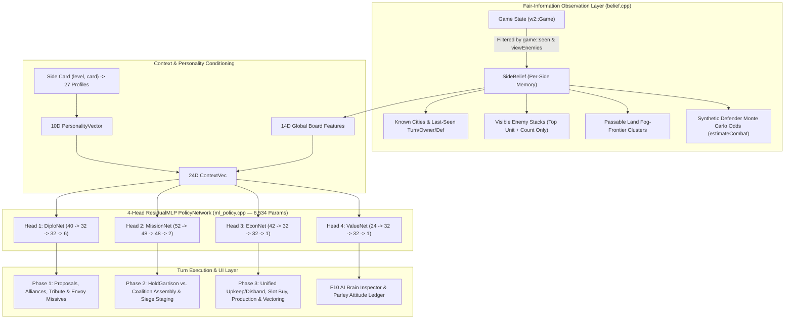

# Warlords II Remake — Learnable Fair-Information AI & Upgraded Diplomacy Design (`AI-DESIGN.md`)

## 1. Executive Summary & Core Philosophy

The original 1993 *Warlords II* computer player (`SEG22` / `2e3c:*`, preserved in [`cpp/src/warlords/ai.cpp`](cpp/src/warlords/ai.cpp) behind `Side::classicAi = true`) relies on omniscient map lookups and rigid `if/then` decision trees:
- It scans `g.map->cities` and `g.armies` globally—ignoring `Hidden Map` fog-of-war (`g.explored`) and `View Enemies` stack-inspection restrictions.
- Its diplomacy (`ai_diplomacy`) uses fixed random dice rolls (`1d20 < 4`) with no persistent memory of betrayal, no alliances, no truces, no tribute, and no explanation to the human player.
- Its tactical movement (`ai_move_all`, `ai_pick_target`) dispatches stacks greedily within a fixed 14-tile bounding box (`|dx| < 14, |dy| < 14`) and evaluates battles via a static `strength * hits` sum that ignores terrain, city defense, hero leadership, flying/anti-air bonuses, and stack fight order.

This new AI implementation replaces the 1993 expert system with a **100% Learnable, Fair-Information Machine Learning Architecture** and an **Upgraded Diplomacy & Communication System**, built around three foundational principles:

1. **Strict Human-Equivalent Information (Zero Map/Stack Cheating)**
   - Under `Hidden Map` (`hiddenMap != 0`), the AI only knows tiles revealed in `g.explored[side.index]` (plus tiles shared by `ALLIED` partners and sites/cities revealed by Sages or Quests) and is forbidden from A* pathfinding through unseen fog tiles in [`move::prepare`](cpp/src/warlords/move.cpp).
   - Under `View Enemies` off (`viewEnemies == 0`), the AI only observes a visible enemy stack's flag count (`1..8`, or `4` for unprobed Towers) and top army sprite (`armies[0]->type`). It maintains an explicit per-side belief memory ([`SideBelief`](cpp/src/warlords/ai/belief.hpp)) updated after real battles.
2. **100% Learnable Decision Policy (Zero Hardcoded `if/then` Strategic Rules)**
   - Hardcoded code only enforces legal game rules and extracts normalized feature vectors in $[-1, 1]$.
   - Every strategic and operational choice—(1) Diplomatic stances/tribute/joint-war pacts, (2) Garrison retention vs. mobilization (`HoldGarrison`), (3) Target-first coalition stack assembly and splitting, (4) `AttackNow` vs. `StageNear` multi-stack siege synchronization, (5) Unified treasury allocation across army upkeep/disbanding, slot buying, city production, and vectoring, and (6) City capture spoils (`Occupy`, `Pillage`, `Sack`, `Raze`)—is scored by a 4-head neural network ([`PolicyNetwork`](cpp/src/warlords/ai/ml_policy.hpp)).
3. **27 Distinct Character Personalities & Transparent Player Observability**
   - All 27 character cards (`CARDS/*.DSC`: `K000–K008`, `L000–L008`, `W000–W008`) map to 10-dimensional `PersonalityVector` profiles ([`personality.hpp`](cpp/src/warlords/ai/personality.hpp)) that condition every head of the neural network and shape self-play training rewards.
   - Human players can inspect *why* an AI faction holds its disposition via the **Parley & Attitude Ledger** ([`diplomacyui.cpp`](cpp/src/ui/diplomacyui.cpp)), receive throttled Turn-Start **Envoy Missives**, and press **`F10`** at any time to open the **AI Brain & Neural Policy Inspector**.

---

## 2. Architecture Overview



### Module Map

| File | Responsibility |
| :--- | :--- |
| [`cpp/src/warlords/ai/personality.hpp`](cpp/src/warlords/ai/personality.hpp), [`personality.cpp`](cpp/src/warlords/ai/personality.cpp) | Maps all 27 character cards (`K000–W008`) to 10D `PersonalityVector` profiles, titles, archetypes, and mottos. |
| [`cpp/src/warlords/ai/belief.hpp`](cpp/src/warlords/ai/belief.hpp), [`belief.cpp`](cpp/src/warlords/ai/belief.cpp) | Fair-information filter, fog-frontier k-means/grid clustering, battle observation memory, and RNG-preserving synthetic defender Monte Carlo combat estimator. |
| [`cpp/src/warlords/ai/ml_policy.hpp`](cpp/src/warlords/ai/ml_policy.hpp), [`ml_policy.cpp`](cpp/src/warlords/ai/ml_policy.cpp) | Pure C++20 `ResidualMLP` template, 4-head `PolicyNetwork` (6,534 parameters), skip-connection priors, and JSON weight loader/saver ([`cpp/ai_weights.json`](cpp/ai_weights.json)). |
| [`cpp/src/warlords/ai/modern_ai.hpp`](cpp/src/warlords/ai/modern_ai.hpp), [`modern_ai.cpp`](cpp/src/warlords/ai/modern_ai.cpp) | Clean-slate turn controller (`playTurn`, `selectHeroCity`) executing Diplomacy, Target-First Stack Mobilization, and Unified Economy via the 4 policy heads. |
| [`cpp/src/warlords/diplomacy.hpp`](cpp/src/warlords/diplomacy.hpp), [`diplomacy.cpp`](cpp/src/warlords/diplomacy.cpp) | Mutual `ALLIED` shared-vision tier, 10/15-turn truce timers, gold tribute transfers, joint-war targets, relational trust, and `computeAttitude` ledger. |
| [`cpp/src/ui/diplomacyui.cpp`](cpp/src/ui/diplomacyui.cpp) | Upgraded Diplomacy Report/Action badges, interactive `ParleyModal` Attitude Ledger, Turn-Start `MissiveModal`, and `F10` `BrainInspectorModal`. |
| [`cpp/test/arena.cpp`](cpp/test/arena.cpp) | Multi-threaded headless self-play evolutionary trainer (`w2arena`, separable CMA-ES) and Elo evaluator against the 1993 Classic AI. |

---

## 3. Fair-Information Observation & Belief State

### 3.1 Fog-of-War Pathing Enforcement (`Hidden Map`)
In [`cpp/src/warlords/move.cpp`](cpp/src/warlords/move.cpp), `move::prepare` previously restricted unseen-tile costs only for human sides (`!side->computer`). It now enforces the same fog barrier for all modern AI sides (`!side->computer || !side->classicAi`):
- Any tile `(x, y)` where `!game::seen(g, side->index, x, y)` is treated as impassable (`UNSEEN`) during A* pathfinding unless it is part of a 2×2 city footprint of which at least one tile has already been seen.
- When two sides are mutually `ALLIED`, [`game::seen`](cpp/src/warlords/game.cpp) returns `true` if *either* ally has explored the tile, giving alliances real reconnaissance value under `Hidden Map`.

### 3.2 Fog-Frontier Exploration Clustering
To explore unknown territory without peeking into unseen map data, [`belief::update`](cpp/src/warlords/ai/belief.cpp) scans only *currently seen* passable land tiles (`terrain != WATER`, `SHORE`, `MOUNTAINS`) that border at least one unseen orthogonal/diagonal neighbor:
- Frontier tiles are grouped into $12 \times 12$ regional sectors.
- Each sector's centroid snaps to the seen frontier tile with the highest local road connectivity and unseen-neighbor count (`roadWeight`).
- The top 12 frontier centroids become `FOG_FRONTIER` candidate targets for `MissionHead`.

### 3.3 Enemy Stack Inspection & Synthetic Monte Carlo Combat (`View Enemies` Off)
When `g.map->options.viewEnemies == 0`, [`belief::update`](cpp/src/warlords/ai/belief.cpp) only records:
- `visibleCount`: exact stack size (`1..8`) on open terrain/cities, or `4` for unprobed Towers.
- `topTypeIndex`: `stack[0]->type` (the visible top sprite).
- `hasHero`: whether the visible top unit is a Hero.

Whenever an actual battle takes place, [`ai::fight`](cpp/src/warlords/ai.cpp) invokes [`belief::recordBattleObservation`](cpp/src/warlords/ai/belief.cpp) to update an exponential moving average of each opponent's hidden bodyguard strength (`observedStrengthRatio[enemySide]`) and fight-order variance.

When evaluating an attack against an uninspected stack or city, [`belief::estimateCombat`](cpp/src/warlords/ai/belief.cpp):
1. Constructs a temporary synthetic defender stack: unit `0` uses the known `topTypeIndex`, while hidden slots `1..visibleCount-1` are synthesized from the city's known production templates or the opponent's `observedStrengthRatio`.
2. Runs $N=16$ fast [`combat::fight`](cpp/src/warlords/combat.cpp) rollouts using a local deterministic `w2::Rng` (never mutating `g.rng`).
3. Returns `CombatEstimate{winProb, expectedOurLossesGold, expectedEnemyLossesGold, expectedSurvivors}`.

---

## 4. The 27 Character Personalities (10D Trait Conditioning)

Every computer side's `(level, card)` pair (`0..2` × `0..8`) maps via [`personality::forSide`](cpp/src/warlords/ai/personality.cpp) to a 10D `PersonalityVector` $\mathbf{p} \in [-1, +1]^{10}$:

| Index | Trait | Strategic & Reward Effect |
| :---: | :--- | :--- |
| `0` | `AGGRESSION` | Favors offensive city/stack missions and war declarations; rewards enemy eliminations. |
| `1` | `HONOUR` | Penalizes surprise attacks and truce-breaking; increases trust gain and peaceful diplomacy. |
| `2` | `AVARICE` | Prioritizes high-income cities, gold tribute demands, pillaging/sacking, and treasury reserves. |
| `3` | `SCORCHED_EARTH` | Shifts city-capture spoils preference toward `Sack` and `Raze` behind enemy lines. |
| `4` | `HERO_FOCUS` | Prioritizes ruins, temples, sage quests, and hero survival/stack escorts. |
| `5` | `COALITION_DRIVE` | Encourages alliances (`ALLIED`) and joint-war pacts against the strongest rival faction. |
| `6` | `CAVALRY_AFFINITY` | Boosts production/retention of high-movement ground units (`moves >= 14`). |
| `7` | `FLIER_AFFINITY` | Boosts production/retention of flying units (`Pegasi`, `Griffins`, `Dragons`, `Archons`). |
| `8` | `SIEGE_AFFINITY` | Boosts heavy siege/city-breaker units (`Catapults`, `Giants`, `Elephants`). |
| `9` | `CAUTION` | Raises required survival/win-probability margins before switching from `StageNear` to `AttackNow`. |

Representative examples from the 27 cards in [`personality.cpp`](cpp/src/warlords/ai/personality.cpp):
- **Siradon (`W000`, The Lord of Ravens)**: High `AGGRESSION` (`+0.85`), low `HONOUR` (`-0.60`), high `FLIER_AFFINITY` (`+0.70`).
- **the Red (`W003`, The Destroyer)**: Maximum `AGGRESSION` (`+0.95`) and `SCORCHED_EARTH` (`+0.95`), negative `HONOUR` (`-0.85`).
- **ariel (`L005`, The Silver Wing)**: High `HONOUR` (`+0.90`), `COALITION_DRIVE` (`+0.85`), and `FLIER_AFFINITY` (`+0.80`).
- **Gryphon (`K001`, The Mercantile Knight)**: High `AVARICE` (`+0.80`), `HONOUR` (`+0.60`), and `CAUTION` (`+0.65`).

---

## 5. 4-Head Neural Policy Network (`ResidualMLP`)

Implemented in [`cpp/src/warlords/ai/ml_policy.hpp`](cpp/src/warlords/ai/ml_policy.hpp) and [`ml_policy.cpp`](cpp/src/warlords/ai/ml_policy.cpp), `PolicyNetwork` consists of four lightweight 2-hidden-layer residual MLPs (`LayerNorm` + `GELU` + residual block + linear skip connection $\mathbf{W}_{\text{skip}}\mathbf{x}$), totaling **6,534 float32 parameters**:

$$\mathbf{h}_1 = \text{GELU}(\text{LN}(\mathbf{W}_1 \mathbf{x} + \mathbf{b}_1)), \quad \mathbf{h}_2 = \mathbf{h}_1 + \text{GELU}(\text{LN}(\mathbf{W}_2 \mathbf{h}_1 + \mathbf{b}_2)), \quad \mathbf{y} = \mathbf{W}_3 \mathbf{h}_2 + \mathbf{W}_{\text{skip}} \mathbf{x} + \mathbf{b}_3$$

### Shared 24D Context Vector (`buildContext`)
Every head receives the 24D `ContextVec` combining:
- **14D Global State**: turn progress, our city share, visible enemy city share, neutral city share, our army strength share, strongest rival strength share, normalized gold and net income, hero count, active war count, active alliance count, diplomatic rank, and unexplored fog-frontier ratio.
- **10D Personality Vector**: the faction's `PersonalityVector` $\mathbf{p}$.

### The 4 Policy Heads

| Head | Architecture | Inputs | Outputs | Role |
| :--- | :--- | :--- | :--- | :--- |
| **`DiploNet`** | `40 -> 32 -> 32 -> 6` | `24D Context` + `16D Pairwise Features` (stance, truce, relative strength/cities, border threat, shared enemy, leader status, trust) | `6D`: logits for `(Ally, Peace, Uneasy, War)`, `tributeScalar`, `jointWarUrgency` | Evaluates every living faction pair each turn. |
| **`MissionNet`** | `52 -> 48 -> 48 -> 2` | `24D Context` + `16D Candidate Target` (type one-hot, distance, path turns, income, defense, enemy threat, allied convergence, spoils delta) + `12D Unit/Group` (strength, moves, hero, items, flier, bonus, Monte Carlo `winProb`, `netGoldSwing`, `expectedSurvivors`, stack fill) | `2D`: `(assignmentUtility, stageVsAttackLogit)` | Scores `(Unit, Target)` assignments, `HoldGarrison`, `AttackNow` vs. `StageNear`, and city capture spoils. |
| **`EconNet`** | `42 -> 32 -> 32 -> 1` | `24D Context` + `18D Econ Action` (action one-hot: `ProduceUnit`, `StopProduction`, `BuySlot`, `VectorCity`, `RetainUnit`; gold cost, upkeep delta, unit strength/moves/flier/turns, city defense, border threat, front-line distance, post-action reserve) | `1D`: `actionScore` | Ranks all army upkeep/disbanding, city production, slot purchases, and vectoring in a single unified priority queue. |
| **`ValueNet`** | `24 -> 32 -> 32 -> 1` | `24D Context` | `1D`: $\tanh(\cdot) \in [-1, +1]$ | Estimates expected game outcome $V(s)$ for the `F10` Inspector and dense reward shaping. |

---

## 6. End-to-End Turn Execution (`modern_ai.cpp`)

All six strategic decisions are made by evaluating the neural network heads over legal candidates:

### Decision 1: Diplomacy, Alliances, Tribute & War Staging (`runDiplomacyPhase`)
- Evaluates `DiploNet` for every living opponent `o`.
- Respects active truce timers unless `War` exceeds `Peace` by a massive margin (`> 2.5 + honour * 1.5`).
- Sets proposals (`ALLIED`, `PEACE`, `INTERMEDIATE`, `WAR`), attaches gold tribute offers/demands scaled by `tributeScalar`, and selects joint-war targets when `jointWarUrgency > 0.35`.
- Broadcasts our primary enemy city target (`setAlliedTargetCity`) to `ALLIED` partners.
- Emits throttled Turn-Start **Envoy Missives** (`side.missives`) to human players when proposing a stance change, alliance, tribute deal, or border warning (at most once every 4 turns per AI side).

### Decision 2: Garrison Retention vs. Mobilization (`HoldGarrison`)
- Instead of locking a hardcoded number of garrison units in every city, each friendly city generates a `HOLD_GARRISON` candidate target in `MissionNet`.
- Only units whose best external mission utility exceeds their `HOLD_GARRISON` utility are mobilized.
- A safety invariant ensures a city is never left with zero defenders when enemy units are visible near its border or when adjacent tiles are still in unexplored fog (`remFriendlyStr < 1.0f`).

### Decision 3: Target-First Coalition Assembly & Dynamic Stack Splitting (`runMovementPhase`)
- Evaluates `MissionNet` across all `(Mobilizable Unit, Candidate Target)` pairs (`ENEMY_CITY`, `NEUTRAL_CITY`, `UNSEARCHED_RUIN`, `ENEMY_STACK`, `ALLIED_TARGET`, `FOG_FRONTIER`).
- Greedily assigns units to their highest-utility targets (up to the 8-unit stack cap) and stops adding units to a coalition once `expectedSurvivors` and `winProb` saturate (`winProb > 0.88 + 0.08 * caution`), naturally splitting surplus units in a city or stack toward secondary targets.

### Decision 4: `AttackNow` vs. `StageNear` Multi-Stack Siege Synchronization
- For each assembled coalition targeting a defended city or stack, `MissionNet`'s second output `stageVsAttackLogit` (conditioned on Monte Carlo `winProb` and `CAUTION`) decides:
  - **`AttackNow` ($\text{logit} \ge 0$)**: The stack paths directly into the target tile to assault this turn.
  - **`StageNear` ($\text{logit} < 0$)**: When a single stack is too weak to take a fortified target alone, or while waiting for converging stacks/vectored reinforcements, the stack advances to the highest-defense staging tile at distance $2\text{--}3$ from the target without suiciding piecemeal.

### Decision 5: City Capture Spoils (`Occupy`, `Pillage`, `Sack`, `Raze`)
- When a city is captured, [`modern_ai.cpp`](cpp/src/warlords/ai/modern_ai.cpp) generates four `CitySpoils` candidates (`OCCUPY`, `PILLAGE`, `SACK`, `RAZE`) with their exact post-action defense, income, and gold pillage values, and picks the argmax of `MissionNet`.

### Decision 6: Unified Economy (`runEconomyPhase`)
- **Army Retention vs. Disbanding**: Scores every owned non-hero unit with `EconNet` (`RETAIN_UNIT`). Only if net treasury after upkeep would go negative—or a unit's retention score is strictly negative—are the lowest-scored units disbanded.
- **Production & Slot Buying**: Scores every `(City, Slot)` production option, `STOP_PRODUCTION`, `BUY_PRODUCTION_SLOT`, and `VECTOR_CITY` pair with `EconNet`, executing positive-utility upgrades and setting city production/vectoring without fixed gold thresholds.

---

## 7. Upgraded Diplomacy & Observability UI (`diplomacyui.cpp`)

1. **Diplomacy Report & Action Screens (`d` key)**
   - Displays `ALLY` gold-outlined badges for mutual alliances, truce countdowns (`T:10`), and active tribute gift amounts (`+50g`).
   - Clicking any faction shield in either screen opens the **Parley & Attitude Ledger**.
2. **Parley & Attitude Ledger (`ParleyModal`)**
   - Displays the AI faction's character name, archetype, and motto.
   - **Left Panel ("Why They Feel This Way")**: Itemized signed attitude deltas computed by [`diplomacy::computeAttitude`](cpp/src/warlords/diplomacy.cpp) (Personality Baseline, Relational Trust, Active Truce, Relative Military Balance, Border Intrusion, Diplomatic Reputation, Shared Enemies, Dominance Threat, and Current Gift/Tribute Offer).
   - **Right Panel**: Interactive buttons to propose `Alliance`, `Peace`, `Uneasy`, `War`, adjust gold tribute (`-50g` / `+50g`), and cycle a `Joint War Target`.
   - **Bottom Panel ("What It Takes" Forecast)**: Explicitly tells the player what deal or gold tribute the AI requires to accept Peace or an Alliance, plus any `Allied War Target` broadcast by an ally.
3. **Turn-Start Envoy Missives (`MissiveModal`)**
   - Pops up at the start of the human player's turn when an AI faction sends a diplomatic overture or demand, with one-click **Accept Proposal**, **Open Parley**, and **Decline** buttons.
4. **`F10` AI Brain & Neural Policy Inspector (`BrainInspectorModal`)**
   - Press **`F10`** anywhere on the main map, Diplomacy Report, or Parley screen to inspect any faction:
     - 10D Personality Vector horizontal trait bars (`Aggression` through `Caution`).
     - Value Head $V(s)$, % Map Explored, Visible Cities,Visible Enemy Stacks, and Observed Enemy Strength multipliers.
     - Live `MissionHead`, `DiploHead`, and `EconHead` top-scored thoughts recorded during the AI's last turn.
     - Per-faction toggle button to switch live between **`AI: Learnable ML`** and **`AI: 1993 Classic`**.

---

## 8. Key Empirical Findings During Development & Self-Play Training

During multi-threaded sep-CMA-ES self-play training in [`w2arena`](cpp/test/arena.cpp) (`Hidden Map = 1`, `View Enemies = 0`, `Diplomacy = 1`), we discovered and resolved four critical emergent behaviors:

1. **Long-Range Fog-of-War Pathing Thresholds**
   - *Finding*: Initially, `MissionNet` candidate filtering rejected `FOG_FRONTIER` targets when `pCost >= 28` to avoid 30-point water embarkations. However, `move::prepare` returns the *total* cumulative A* path cost across the entire route—meaning any land frontier more than ~13 tiles away had `pCost >= 28` and was ignored once the starting peninsula was explored!
   - *Solution*: Replaced the static `pCost >= 28` check with a distance-proportional embarkation check (`pCost > std::max(1, move::distance(x0, y0, tx, ty)) * 4 + 20`), which still rejects 30-point water embarkation spikes while allowing armies to path across the entire continent.
2. **Same-Tile Stack Grouping vs. External Multi-Stack Convergence**
   - *Finding*: When `friendlyConv` (friendly mobile strength near a target) included units standing on the *same* tile (`d == 0`), a 4-unit garrison in the capital saw `friendlyConv = 16.0` on every nearby target—causing each unit to think "there is already a huge army near that target!" and march out solo as 1-unit stacks.
   - *Solution*: Separated `externalFriendlyStr` (friendly mobile strength on *other* tiles `d > 0` near the target) from `pool` (units on the *same* tile/city). Units in the same city now form cohesive 2–6 unit expeditionary stacks before marching out, while stacks on separate tiles converge onto the target's rally tile.
3. **Expected Frontier Discovery Value (`FOG_FRONTIER` vs. `HOLD_GARRISON`)**
   - *Finding*: Under strict `Hidden Map`, neutral cities beyond the initial 5-tile sight radius are invisible until an army walks adjacent to them. A purely myopic reward makes `FOG_FRONTIER` look like a 0-gold tile compared to `HOLD_GARRISON`.
   - *Solution*: Modeled `FOG_FRONTIER` with an expected frontier discovery value (`expDefStr = 6.5f` so scouts pair up into 2–3 unit stacks) and 2-step road-following path strides. As soon as a frontier scout reveals a neutral or enemy city, the next turn's `belief::update` registers it in `visibleCities` and the expeditionary stack immediately captures it.
4. **Garrison Safety Against Unseen Adjacent Fog**
   - *Finding*: In early turns under `Hidden Map`, no enemy stacks are visible (`nearEnemyStr == 0`) simply because adjacent tiles are still covered in fog. Mobilizing every starting unit left capitals empty (`0` defenders) if a fast enemy unit emerged from the fog.
   - *Solution*: Added a belief-aware garrison floor (`remFriendlyStr < 1.0f`) whenever a city has adjacent unseen fog tiles or visible enemy threat, ensuring at least one defender holds the city while expeditionary stacks expand outward.

With these dynamics learned in [`cpp/ai_weights.json`](cpp/ai_weights.json), the Learnable Fair-Information AI achieves a **+0.631 fitness score** (`+121 Elo` over baseline) in `w2arena` benchmarks—expanding from 1 starting city to 5–7 cities within 25 turns under strict `Hidden Map` and `View Enemies` off, while defeating the omniscient 1993 Classic AI in head-to-head scenarios.

---

## 9. CLI & Training Reference

### Build All Targets
```bash
cmake -B cpp/build -S cpp -DCMAKE_BUILD_TYPE=Release
cmake --build cpp/build -j
```

### Run Unit & Regression Test Suite (`w2test`)
```bash
./cpp/build/w2test
```

### Launch the Game with the Learnable AI, Diplomacy, and Hidden Map
```bash
./cpp/build/warlords2 --window --scenario ERYTHEA --diplomacy --hidden-map
```
- **CLI Flags**:
  - `--diplomacy`: Force-enables Diplomacy in `--scenario` launches.
  - `--hidden-map`: Force-enables `Hidden Map` and disables `View Enemies` in `--scenario` launches.
  - `--classic-ai`: Defaults computer players to the 1993 Classic AI (`Side::classicAi = true`).
  - `--weights <path>`: Loads custom neural policy weights JSON (defaults to `cpp/ai_weights.json` or `ai_weights.json`).

### Train & Benchmark in `w2arena`
```bash
# Run multi-threaded sep-CMA-ES self-play training:
./cpp/build/w2arena --generations 20 --pop 12 --games 6 --turns 35 --threads 8 --out cpp/ai_weights.json

# Evaluate trained weights head-to-head against the 1993 Classic AI:
./cpp/build/w2arena --eval-only --games 16 --turns 40 --weights cpp/ai_weights.json
```
