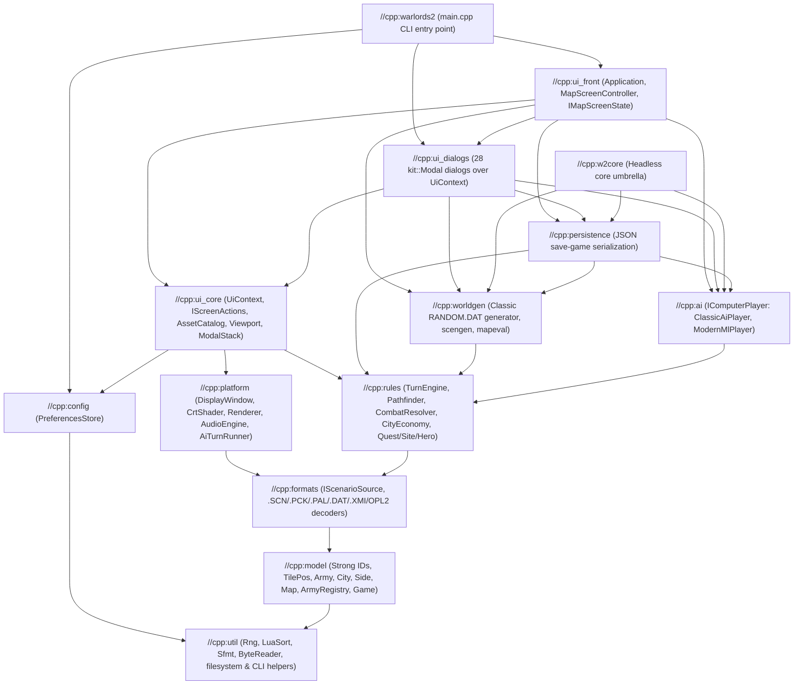

# C++ Architecture (`cpp/`)

The C++23 implementation of Warlords II (`cpp/`) is structured as an acyclic graph of Bazel libraries (`cpp/BUILD.bazel`) built on explicit dependency injection, encapsulated domain entities, and exception-free `absl::StatusOr<T>` boundaries. Core game rules, computer-player strategies, world generation, and save persistence (`//cpp:w2core`) are completely headless and have zero dependency on SDL2 or UI headers, enabling deterministic sub-second unit tests and multi-threaded reinforcement-learning self-play.

---

## 1. Layered Bazel Dependency Graph

Every dependency edge in `cpp/BUILD.bazel` points strictly downward:

| Bazel Target | Directory / Files | Architectural Responsibility |
|---|---|---|
| `//cpp:util` | `cpp/src/util/`, `cpp/src/warlords/{rng,bytes}.*` | Deterministic LCG `Rng`, Lua-compatible `LuaSort`, `Sfmt`, bounds-checked `ByteReader`, filesystem I/O, and `absl::flags` CLI normalization (`ParseCliFlags`). |
| `//cpp:model` | `cpp/src/warlords/model/`, `cpp/src/warlords/types.hpp` | Strong entity IDs, `TilePos`, value records, `IComputerPlayer` interface, and encapsulated domain entities (`Army`, `ArmyRegistry`, `City`, `Side`, `Quest`, `DiplomacyMatrix`, `FogOfWar`, `TurnSchedule`, `Map`, `Game`). |
| `//cpp:formats` | `cpp/src/warlords/{scn,pck,pal,armytype,uidata,xmi,opl,ailfm,aicard,cues,preview,scenarios,scenario_source}.*` | `IScenarioSource` (`DiskScenarioSource`, `MemoryScenarioSource`) and non-throwing `absl::StatusOr<T>` parsers for 1993 `.SCN`, `.PCK`, `.PAL`, `.DAT`, `.XMI`, and AdLib OPL2 FM synthesis. |
| `//cpp:rules` | `cpp/src/warlords/{turn_engine,city_economy,combat,move,pathfinder,diplomacy,hero,site,quest,history,report,slots,travel,rules,game,game_setup}.*` | Pure domain services (`TurnEngine`, `CityEconomy`, `CombatResolver`, `Pathfinder`, `QuestSystem`, `SiteExplorer`, `HeroSystem`), diplomacy rules, and scenario setup. Zero dependency on `//cpp:ai`. |
| `//cpp:ai` | `cpp/src/warlords/ai.{hpp,cpp}`, `cpp/src/warlords/ai/` | Concrete `IComputerPlayer` implementations (`ClassicAiPlayer`, `ModernMlPlayer`), fair-information `SideBelief`, 5-head `PolicyNetwork` (`cpp/ai_weights.json`), and diplomatic attitude scoring. |
| `//cpp:worldgen` | `cpp/src/warlords/{randommap,scengen,mapeval}.*`, `cpp/src/warlords/worldgen/` | Encapsulated 1993 `RANDOM.DAT` map generator (`randommap::Generator`), cross-port `scengen` world builder, and `mapeval` map quality analyzer. |
| `//cpp:persistence` | `cpp/src/warlords/save.{hpp,cpp}` | Ordered JSON (`nlohmann::ordered_json`) save-game serializer and slot inspector, delegating strategy persistence through `IComputerPlayer::SaveState` / `LoadState`. |
| `//cpp:w2core` | Headless umbrella | Aggregates `util`, `model`, `formats`, `rules`, `ai`, `worldgen`, and `persistence` for headless tests and CLI tools. |
| `//cpp:config` | `cpp/src/config/preferences_store.{hpp,cpp}` | `PreferencesStore` managing persistent user settings (`w2-prefs.json`) in `W2_USER_DIR` or `SDL_GetPrefPath`. |
| `//cpp:platform` | `cpp/src/platform/` | RAII wrappers over SDL2 window/scaling (`DisplayWindow`), OpenGL/mesh CRT post-processing (`CrtShader`), 2D rendering (`Renderer`), audio mixing (`AudioEngine`), input (`KeyboardState`, `GamepadInput`), and the `AiTurnRunner` monitor. |
| `//cpp:ui_core` | `cpp/src/ui/{asset_catalog,viewport,modal_stack,screen_actions,ui_context,kit}.*`, `cpp/src/front/{font,layout,menu,pckimage,screen,stonetile}.*` | Core UI primitives, `AssetCatalog`, `Viewport`, `ModalStack`, `IScreenActions`, `UiContext`, and `kit::Modal`. |
| `//cpp:ui_dialogs` | `cpp/src/ui/*.cpp` (excluding `ui_core`), `cpp/src/ui/dialogs.hpp` | All 28 modal dialogs implemented as `kit::Modal` subclasses operating exclusively over `UiContext&` (zero dependency on `//cpp:ui_front`). |
| `//cpp:ui_front` | `cpp/src/front/` (excluding `ui_core`) | `Application` composition root, `MapScreenController`, `IMapScreenState` state machine, map/chrome renderers, and `ScriptPlayer`. |
| `//cpp:warlords2` | `cpp/src/main.cpp` | Parses `absl::flags` into `ApplicationConfig` and invokes `Application::Run`. |

---

## 2. Strong IDs & Domain Model (`//cpp:model`)

`cpp/src/warlords/types.hpp` aggregates the focused headers in `cpp/src/warlords/model/`:

### Strong Entity Identifiers (`model/ids.hpp`)

`StrongId<Tag>` is a zero-overhead `constexpr` value wrapper around an `int` index (`kNone = -1` when unset) providing `Value()`, `IsValid()`, `<=>`, and `AbslHashValue` so distinct entity index spaces cannot be mixed at compile time:

- **`SideId`** (`0..7`) — faction index in `Map::Sides()`.
- **`CityId`** (`0..CityCount()-1`) — city index in `Map::Cities()`.
- **`ArmyId`** — unique, monotonic, never-reused handle assigned by `ArmyRegistry`.
- **`ArmyTypeId`** (`0..63`) — unit template index in `ARMYTYPE.DAT` (`Types`).
- **`SiteId`** (`0..SiteCount()-1`) — temple or ruin index in `Map::Sites()`.
- **`ItemId`** (`0..ItemCount()-1`) — magic item or standard index in `Map::Items()`.
- **`VectorTarget`** (`std::variant<std::monostate, CityId, PlantedStandard>`) — type-safe destination for vectored city production.

### Encapsulated Domain Entities

Stateful domain models are C++ `class`es with `private:` `_`-suffixed members enforcing invariants across mutations, paired with value `struct`s for plain records (`TilePos`, `ArmyType`, `Slot`, `Item`, `Site`, `Options`, `Transit`, `TurnReport`, `HistoryRecord`, `Bugs`):

- **`Army` (`model/army.{hpp,cpp}`):** Represents an individual unit or hero, maintaining `ArmyId`, `SideId` owner, `ArmyTypeId`, strength, movement points, sea/fortified flags, carried `Item*` inventory, road `Transit` state, and automatic spatial-index synchronization when bound to an `ArmyRegistry`.
- **`ArmyRegistry` (`model/army_registry.{hpp,cpp}`):** Lifetime-owning pool (`pool_`) of every `Army` created during a `Game`, active army table (`active_`) kept strictly sorted by ascending table `Slot()`, and synchronized $O(1)$ per-tile spatial lookup (`by_tile_`, `ArmiesOnTile`, `IndexedOnTile`) ordered newest-slot-first.
- **`City` (`model/city.{hpp,cpp}`):** $2 \times 2$-tile settlement tracking `CityId`, `SideId` owner and AI claim, defense/income ratings, up to four build `Slot`s, active slot countdown, and `VectorTarget` routing (`IsNeutral`, `OwnedBy`, `ContainsTile`, `IsVectored`).
- **`Side` (`model/side.{hpp,cpp}`):** Faction entity holding ruler metadata, `SideId`, human/computer control mode, gold treasury, origin and active capital `TilePos`, active `Quest`, queued `DiplomaticMissive`s, and its polymorphic `std::shared_ptr<IComputerPlayer>`.
- **`Quest` (`model/quest.{hpp,cpp}`):** Temple quest tracking the questing hero `ArmyId`, objective progress, and a `Quest::Target` `std::variant<std::monostate, CityId, SideId, ItemId, ArmyTypeId, ArmyId>`.
- **`DiplomacyMatrix` (`model/diplomacy_state.{hpp,cpp}`):** $8 \times 8$ relational matrix enforcing mutual-peace alliance invariants, directional treaty proposals, gold tributes, joint-war requests, truce countdowns, and clamped `[-100, +100]` trust scores.
- **`FogOfWar` (`model/fog_of_war.{hpp,cpp}`):** Per-`SideId` row-major tile exploration masks (`IsExplored`, `MarkExplored`, `MaskFor`) used when Hidden Map is active.
- **`TurnSchedule` (`model/turn_schedule.{hpp,cpp}`):** 8-slot round permutation and active slot cursor (`StartNewRound` applies the 20-swap Random Turns shuffle via `Rng`).
- **`Map` (`model/map.{hpp,cpp}`):** Terrain/road byte grids, active map bounds, `absl::Span` entity views (`Cities()`, `Sites()`, `Items()`, `Signs()`, `Sides()`), and automatically maintained $O(1)$ spatial indices (`CityAtTopLeft`, `CityAtFootprint`, `SiteAt`) rebound across copy, move, and resize operations.
- **`Game` (`model/game_state.{hpp,cpp}`):** Aggregate root owning `Rng`, `Map`, `ArmyRegistry`, `DiplomacyMatrix`, `FogOfWar`, `TurnSchedule`, `Pathfinder`, per-side `TurnReport` news (`TurnNews(SideId)`), fortified towers, chronicle history/deeds/triumphs, and `Bugs` toggles. Tracks the active faction via a single authoritative `CurrentSideIndex()` deriving `CurrentSide()`, and invalidates `Pathfinder` atomically inside `SetCityOwner`.

---

## 3. Domain Services (`//cpp:rules`) & AI Strategies (`//cpp:ai`)

### Domain Services (`//cpp:rules`)

Rule algorithms are organized into focused domain services operating over `Game&`:

- **`Pathfinder` (`move.hpp`, `pathfinder.cpp`):** Builds and caches per-side 1-byte-per-tile movement-cost grids (`grids_`), runs bounded wavefront searches from destinations, maintains the 20-slot route cache (`route_slots_`: slot 0 for routes `< 15` tiles, slots `1..19` for long routes), and executes step-by-step stack walks (`Walk`, `MoveTo`, `PreviewRoute`, `Flood`).
- **`CombatResolver` (`combat.{hpp,cpp}`):** Computes terrain, hero command, item, and stack modifiers; simulates 19 sample battles for Military Advisor odds (`Advise`); runs round-by-round `kDie`/`kDieIntense` combat (`Resolve`, `DecideAttack`); and commits casualties, hero item drops, XP, quest triggers, city capture, and medals (`ApplyAttack`).
- **`TurnEngine` (`turn_engine.{hpp,cpp}`) & `TurnReport` (`model/turn_report.hpp`):** Drives round and turn transitions (`Begin`, `StartTurn`, `HumanProduction`, `EndTurn`, `EndRound`), resets movement, forms fortified encampments, sinks stranded non-flying units on water, eliminates cityless factions, checks victory/surrender conditions, and populates each side's transient `TurnReport` (`produced`, `diplo_news`, `hero_offer`, `quest_news`, `promoted`).
- **`CityEconomy` (`city_economy.{hpp,cpp}`):** Computes city income and army upkeep, advances build countdowns and road-transit deliveries (`RunProduction`), manages standard planting and up-to-4-city vectoring, validates slot purchases (`BuyProduction`), and executes `Occupy`, `Pillage`, `Sack`, and `Raze`.
- **`QuestSystem` (`quest.{hpp,cpp}`):** Assigns distance-bounded temple quests (`Assign`), evaluates turn/combat/capture/item notifications (`Notify`), and grants ally, gold, item, or rich-site revelation rewards (`ChooseReward`).
- **`SiteExplorer` (`site.{hpp,cpp}`):** Seeds ruin guardians, items, gold, allies, and sages at scenario setup; processes temple blessings (`Bless`), guardian duels, ruin searches (`Search`), and sage consultations (`SageList`, `SageShow`, `SageGem`, `SageMap`).
- **`HeroSystem` (`hero.{hpp,cpp}`):** Loads `HERONAM<side>.DAT` candidate rosters, rolls turn-start hero offers (`Offer`), recruits heroes and magical escorts (`Recruit`, consulting `IComputerPlayer::ChooseHeroCity` for AI placement), tracks battle XP and level promotions, and manages ground/carried items.

### Polymorphic `IComputerPlayer` Hierarchy (`//cpp:ai` & `//cpp:opponents`)

`IComputerPlayer` (`model/computer_player.hpp`) defines the strategy contract for autonomous turn play (`PlayTurn` with optional `IAiTurnEvents*` observer), diplomatic deal evaluation (`EvaluateProposal` returning an `AttitudeBreakdown`), hero city placement (`ChooseHeroCity`), quest-city spoils (`OnQuestCapture`), battle memory (`RecordBattle`, `RecordBattleObservation`), and JSON save-state hooks (`SaveState`, `LoadState`):

| Strategy Class | Location | Behaviour & Owned State |
|---|---|---|
| `ClassicAiPlayer` | `warlords/ai/classic_ai_player.{hpp,cpp}` | Faithful 1993 nineteen-phase rule-based AI (`ai/{core,cities,groups,moves,diplomacy,heroes}.cpp`). Owns `AIData`, per-`ArmyId` `ClassicArmyOrder` map, and shared 6-nearest-city `Neighbours` table. |
| `ModernMlPlayer` | `warlords/ai/modern_ml_player.{hpp,cpp}` | Fair-information neural-policy AI (`ai/{belief,ml_policy,modern_*}.cpp`). Owns `SideBelief` fog-of-war tracker, `BattleGrudge`, `AIThought` telemetry (for the F10 Brain Inspector), and evaluates a 5-head `ResidualMLP` `PolicyNetwork` (`DiploNet`, `MissionNet`, `EconNet`, `ValueNet`, `StackValueNet` loaded from `cpp/ai_weights.json`). |
| `RaiderPlayer` | `test/opponents.{hpp,cpp}` | `IClassicBackedPlayer` decorator used in PPO training and evaluation (`w2arena`, `w2aidiag`); raids reachable undefended enemy cities with cheap units before delegating to `ClassicAiPlayer`. |
| `FrozenPlayer` | `test/opponents.{hpp,cpp}` | `IModernBackedPlayer` strategy pinned to an immutable `PolicyNetwork` checkpoint while maintaining its own per-game `SideBelief` and grudge state. |

---

## 4. Platform RAII Subsystems & `AiTurnRunner` Monitor (`//cpp:config`, `//cpp:platform`)

All SDL2, OpenGL, audio, and preference resources are encapsulated in non-copyable RAII classes with zero module-static globals:

- **`PreferencesStore` (`config/preferences_store.{hpp,cpp}`):** Reads and writes `w2-prefs.json` via non-throwing `nlohmann::ordered_json::parse`, resolving the user directory from `W2_USER_DIR` (for hermetic tests) or `SDL_GetPrefPath`.
- **`display::DisplayWindow` (`platform/display.{hpp,cpp}`):** Owns the `SDL_Window*`, `SDL_Renderer*`, and offscreen supersampling/CRT target texture, translating coordinates across **Device** pixels, logical **UI** pixels (`640x480` minimum), and **Map** pixels (`40` per tile).
- **`crt::CrtShader` (`platform/crt.{hpp,cpp}`):** Renders the offscreen canvas through a GLSL 1.20 CRT shader (barrel curvature, scanlines, RGB aperture grille, multi-pass halation glow pyramid, corner vignette), falling back automatically to a subdivided `SDL_RenderGeometry` bowed mesh on software renderers.
- **`gfx::Renderer` (`platform/gfx.{hpp,cpp}`):** Immediate-mode 2D drawing state stack (`Push`/`Pop`, `Translate`, `Scale`, `SetScissor`, `SetColor`), `gfx::Quad` sub-rectangles, and RAII `gfx::Image` textures guarded by `SdlRendererWeakRef`.
- **`sound::AudioEngine` (`platform/sound.{hpp,cpp}`):** Thread-safe 44.1 kHz stereo SDL audio mixer (`AudioCallback` with `SDL_AudioSpec::userdata = this`, synchronized via RAII `ScopedDeviceLock` over `SDL_LockAudioDevice`) streaming Ogg Vorbis tracks (`pre-rendered-sound/`), live `w2::AilFm` AdLib OPL2 `.XMI` FM synthesis, `.8SN` sound effects, and queued advisor speech.
- **`keys::KeyboardState` (`platform/keys.{hpp,cpp}`) & `pad::GamepadInput` (`platform/pad.{hpp,cpp}`):** Tracks depressed LÖVE-named keys and translates analog sticks, triggers, and face buttons into virtual cursor motion, map panning, and clicks.

### `AiTurnRunner` Dijkstra Monitor (`platform/ai_turn_runner.{hpp,cpp}`)

`AiTurnRunner` serializes background computer-turn execution on a 16 MB worker thread with main-thread UI animation playback without coroutines or exceptions:

- **Single-Token Mutual Exclusion:** `turn_mutex_` (`absl::Mutex` + `ABSL_GUARDED_BY`) guards `owner_` (`TurnOwner::kMain` vs `TurnOwner::kWorker`), `pending_event_`, `finished_`, and `abort_requested_`. Predicate waiting (`turn_mutex_.Await(absl::Condition(...))`) ensures at most one thread touches `Game` state at any instant, and neither the worker `TurnBody` nor any `ITurnObserver` callback is ever invoked while `turn_mutex_` is held.
- **Typed Event Stream & Cooperative Unwind:** Worker events cross the monitor as `TurnEvent` (`std::variant<PauseEvent, WalkEvent, AssaultEvent, PhaseProgressEvent, FallenEvent, NoHumansEvent, TurnDoneEvent>`). Returning `TurnControl::kAbort` from `ITurnObserver::OnTurnEvent` or calling `AiTurnRunner::Abort()` (invoked automatically by `~AiTurnRunner()`) latches `abort_requested_` so `IAiTurnEvents` callbacks return `false` and the worker unwinds cleanly via early returns before joining.

---

## 5. UI Dependency Injection & Front-End State Machine (`//cpp:ui_core`, `//cpp:ui_dialogs`, `//cpp:ui_front`)

### `UiContext` & `//cpp:ui_core`

- **`AssetCatalog` (`ui/asset_catalog.{hpp,cpp}`):** Owns the decoded scenario palette, cached `.PCK` sprite textures, `screen::Screen` control geometry (`FILE.DAT` / `BUTTON.DAT`), and proportional bitmap `Font` instances.
- **`Viewport` (`ui/viewport.{hpp,cpp}`):** Maintains map camera coordinates, integer zoom level (`1x`/`2x`/`3x`), and responsive main-screen panel rectangles (`layout::Layout`).
- **`ModalStack` (`ui/modal_stack.{hpp,cpp}`):** Ordered stack of active `std::shared_ptr<kit::Modal>` dialogs handling draw order, input capture, right-click infobox dismissal, and main-bar greying.
- **`IScreenActions` (`ui/screen_actions.hpp`):** Abstract interface implemented by `MapScreenController` exposing main-screen commands (`OpenCity`, `OpenStart`, `TakeLoaded`, `StartAssault`, `PresentVictory`, `PlayComputer`, `Quit`, ...) and shared strategic-map/hero renderers to dialogs without upward dependencies.
- **`UiContext` (`ui/ui_context.{hpp,cpp}`):** Non-owning dependency-injection bundle aggregating references to `DisplayWindow`, `Renderer`, `AudioEngine`, `KeyboardState`, `GamepadInput`, `PreferencesStore`, `AssetCatalog`, `Viewport`, `ModalStack`, `IScreenActions`, and active session pointers (`Game*`, `Side*`, `Selection`).

### The 28 Modal Dialogs (`//cpp:ui_dialogs`)

Every dialog in `cpp/src/ui/` (declared in `cpp/src/ui/dialogs.hpp`) subclasses `kit::Modal` (`ui/kit.hpp`) with an injected `UiContext&`:

1. `about` (`about.cpp`) — About box and version info.
2. `advisor` (`advisor.cpp`) — Spoken `FILE.DAT` advisor prompt modal.
3. `armybonus` (`armybonus.cpp`) — Army combat modifier and bonus breakdown report.
4. `buyprod` (`buyprod.cpp`) — City production slot purchase dialog.
5. `choose` (`choose.cpp`) — Scrollable list chooser modal.
6. `city` (`city.cpp`) — Four-mode City dialog (Info, City overview, Production, Vectoring).
7. `city_victory` (`city_victory.cpp`) — `CityVictoryModal` (`Occupy` / `Pillage` / `Sack` / `Raze` prompt on city capture).
8. `diplomacyui` (`diplomacyui.cpp`) — $8 \times 8$ Diplomacy matrix, Envoy Action bar, Parley & Attitude Ledger, Turn-Start Missives, and F10 AI Brain & Neural Policy Inspector.
9. `ending` (`ending.cpp`) — Faction elimination popups and final victory/defeat screen.
10. `fightorder` (`fightorder.cpp`) — Per-faction 28-slot Army Fighting Order editor.
11. `help` (`help.cpp`) — Hypertext `.GFX` help viewer (`HELP/*.GFX`).
12. `hero_offer` (`hero_offer.cpp`) — `HeroOfferModal` turn-opening hero recruitment dialog.
13. `heroinfo` (`heroinfo.cpp`) — Hero stats and carried item management dialog.
14. `historyui` (`historyui.cpp`) — Four-tab Empire History graphs, chronicle deeds, and Triumphs tally.
15. `honours` (`honours.cpp`) — Hero level promotion and unit medal ceremony popups.
16. `infobox` (`infobox.cpp`) — Hold-to-view right-click control help and army/type inspection cards.
17. `input` (`input.cpp`) — Single-line text input and yes/no confirmation modal.
18. `items` (`items.cpp`) — Ground and carried item pickup/drop dialog.
19. `levels` (`levels.cpp`) — Live faction human/computer/difficulty switcher.
20. `miladvisor` (`miladvisor.cpp`) — Pre-battle Military Advisor odds dialog.
21. `questnews` (`questnews.cpp`) — Quest completion reward and failure announcement popup.
22. `questui` (`questui.cpp`) — Active quest objective and strategic-map target viewer.
23. `reports` (`reports.cpp`) — Five-tab Reports screen (Armies, Cities, Gold, Hats, Winning).
24. `resign` (`resign.cpp`) — Faction resignation confirmation flow.
25. `ruin` (`ruin.cpp`) — Ruin and temple strategic-map locator dialog.
26. `savegame` (`savegame.cpp`) — Ten-slot Save/Load game browser.
27. `search` (`search.cpp`) — Ruin/temple/sage exploration and message popups (`Say`, `ShowMessage`).
28. `settings` / `shortcuts` / `signpost` / `spoils` / `stackui` / `start` / `tileinfo` / `turn_banner` / `tutorial` — Game Settings (`settings.cpp`), Customize Shortcuts (`shortcuts.cpp`), Signpost reader (`signpost.cpp`), Pillage/Sack spoils summary (`spoils.cpp`), Stack inspector (`stackui.cpp`), Title & Scenario/Random-World setup (`start.cpp`), Hat tile inspector (`tileinfo.cpp`), `TurnBannerModal` (`turn_banner.cpp`), and contextual Tutorial cards (`tutorial.cpp`).

### `MapScreenController`, `IMapScreenState` & `Application` (`//cpp:ui_front`)

- **`Application` (`front/application.{hpp,cpp}`):** Stack-allocated composition root constructing SDL, `PreferencesStore`, `DisplayWindow`, `Renderer`, `AudioEngine`, `KeyboardState`, `GamepadInput`, `AssetCatalog`, `Viewport`, `ModalStack`, `ScriptPlayer`, `MapScreenController`, and `UiContext` in dependency order and tearing them down deterministically in reverse order.
- **`MapScreenController` (`front/map_screen_*.{hpp,cpp}`):** Implements `IScreenActions`, owns the active `std::unique_ptr<Game>`, dispatches menu/control actions and context-sensitive `PointerCursor` states, renders the terrain/fog/stacks/minimap/bottom bar, and delegates modal-free map interaction to `state_` (`std::unique_ptr<IMapScreenState>`):
  - **`HumanTurnState` (`front/human_turn_state.cpp`):** Default interactive state during a human faction's turn.
  - **`MapDragState` (`front/map_screen_input.cpp`):** Left-drag camera panning state; suspends `resume_state_` until mouse release.
  - **`StackWalkingState` (`front/stack_walking_state.cpp`):** Tile-by-tile movement animation; suspends `HumanTurnState` or `ComputerTurnState` in `resume_state_` and notifies `OnSubstateFinished` when complete.
  - **`AssaultAnimationState` (`front/assault_animation_state.cpp`):** Plays the `WAR.PCK` map fire cloud (`Phase::kCloud`), casualty-by-casualty battle window (`Phase::kBattle`), and outcome banner (`Phase::kOver`), then restores `resume_state_`.
  - **`ComputerTurnState` (`front/computer_turn_state.cpp`):** Drives `AiTurnRunner` frame by frame (`StepFrame` / `Resume`), transitioning into `StackWalkingState`, `AssaultAnimationState`, or `ModalStack` popups on visible `TurnEvent`s.
  - **`GameOverState` (`front/map_screen_state.hpp`):** Terminal map-inspection state once no human faction remains.

---

## 6. Test & Verification Architecture

Every change is gated by `sh tools/check.sh`, which runs four verification stages:

### 1. Bazel Unit, Integration & Golden Suites (`bazel test //cpp/...`)

- **`//cpp:headless_tests` (11 pure C++ GoogleTest targets, zero SDL dependency — also run on Linux CI in `.github/workflows/cpp.yml`):**
  - `//cpp:model_gtest` (`test/model_test.cpp`) — Strong IDs, `TilePos`, `ArmyType`, `.SCN` views, and invariant suites for `Map`, `Game`, `ArmyRegistry`, `DiplomacyMatrix`, `FogOfWar`, `TurnSchedule`, and `Quest`.
  - `//cpp:formats_and_ui_data_test` (`test/formats_and_ui_data_test.cpp`) — `.SCN`, `.PCK`, `.PAL`, `ARMYTYPE.DAT`, `FILE.DAT`/`BUTTON.DAT`, `slots`, and AdLib OPL2/`.XMI` FM synthesis parity.
  - `//cpp:rules_setup_and_turn_test` (`test/rules_setup_and_turn_test.cpp`) — Scenario setup (`TEST_P` across all 7 scenarios), turn loop, upkeep, neutral garrisons, and round-end elimination.
  - `//cpp:rules_movement_and_sea_test` (`test/rules_movement_and_sea_test.cpp`) — `Pathfinder` cost grids, route cache, embarking/disembarking, flying stacks, fog-of-war sight radii, and fortified towers.
  - `//cpp:rules_combat_and_capture_test` (`test/rules_combat_and_capture_test.cpp`) — `CombatResolver` modifiers, siege/cancel abilities, medals, hero XP, and city spoils/vectoring.
  - `//cpp:rules_heroes_sites_quests_test` (`test/rules_heroes_sites_quests_test.cpp`) — `HeroSystem`, `SiteExplorer`, `QuestSystem`, sage revelations, and `Bugs` compatibility coverage.
  - `//cpp:rules_diplomacy_test` (`test/rules_diplomacy_test.cpp`) — Treaties, alliances, war declarations, and backstab penalties.
  - `//cpp:ai_classic_test` (`test/ai_classic_test.cpp`) — `ClassicAiPlayer` 19-phase decisions, `.DAT` character cards, city claims, and multi-turn `TEST_P` scenario games.
  - `//cpp:ai_modern_test` (`test/ai_modern_test.cpp`) — `ModernMlPlayer` fair-information `SideBelief`, `PolicyNetwork` forward/backward analytic gradients, `RaiderPlayer`/`FrozenPlayer` opponents, and JSON weight loading.
  - `//cpp:worldgen_test` (`test/worldgen_test.cpp`) — Classic 1993 `RANDOM.DAT` generator, fair capitals, `scengen`, and `mapeval` hard-rule diagnostics.
  - `//cpp:persistence_test` (`test/persistence_test.cpp`) — Full-state `save::Encode` / `save::Decode` round-trips across active turns, quests, road transit, and AI strategies.
- **Hermetic Platform & UI GoogleTest Suites (`SDL_VIDEODRIVER=dummy`, `SDL_AUDIODRIVER=dummy`):**
  - `//cpp:platform_raii_test` (`test/platform_raii_test.cpp`) — `PreferencesStore`, `AiTurnRunner` monitor concurrency/cancellation, `DisplayWindow`, `CrtShader`, `Renderer`, and `AudioEngine`.
  - `//cpp:ui_core_test` (`test/ui_core_test.cpp`) — `AssetCatalog`, `Viewport`, `ModalStack`, `UiContext`, and `kit::Modal` lifecycle.
- **Golden Game, World & Screen Regression Suites:**
  - `//cpp:golden_test` (`test/golden.sh`) — Verifies 15 full-game `w2trace` logs, 12 `w2scengen` worlds, and 24 `w2mapeval` classic/fair random maps against `cpp/test/golden/`.
  - `//cpp:ui_test` (`test/ui_test.sh`) — Drives `warlords2` headlessly through `cpp/test/ui/dialogs.txt` (`ScriptPlayer`) and verifies SHA-256 hashes of rendered screens against `cpp/test/golden/ui.sha256`.

### 2. Cross-Port Equivalence & Static Analysis

- **`sh cpp/test/compare.sh`:** Runs 15 all-computer games (covering Hidden Map, Diplomacy, Random Worlds, and mid-game save/load round-trips) in both LuaJIT (`love2d/`) and C++ (`//cpp:w2trace`) and checks turn-by-turn byte identity.
- **`sh cpp/test/scengen_compare.sh 1 4`:** Generates Continents, Pangaea, and Islands worlds in C++ (`//cpp:w2scengen`), JavaScript (`web/`), and LuaJIT (`love2d/`) and verifies 24/24 byte-identical scenario directories.
- **`sh tools/tidy.sh`:** Runs `clang-tidy` (`cpp/.clang-tidy`, `WarningsAsErrors: '*'`) across every translation unit and header in `cpp/src/` and `cpp/test/`, requiring **0 findings**.
