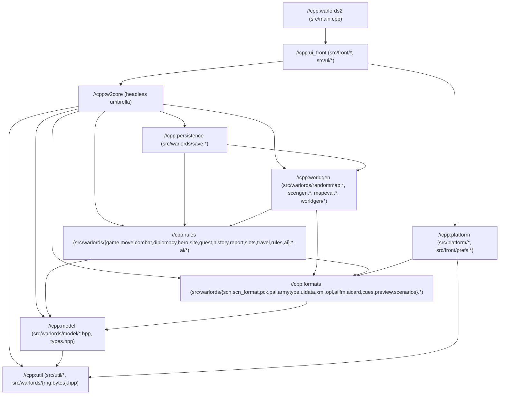

# C++ Architecture (`cpp/`)

The C++23 implementation of Warlords II (`cpp/`) is organized into strict, acyclic Bazel library layers (`cpp/BUILD.bazel`). The game rules, AI, world generation, and save persistence (`//cpp:w2core`) are completely headless and never depend on SDL2 or the UI, enabling fast deterministic testing and multi-threaded AI self-play training.

---

## 1. Layered Dependency Graph

Every arrow in `cpp/BUILD.bazel` points strictly downward:



| Layer Target | Directory / Files | Responsibility |
|---|---|---|
| `//cpp:util` | `cpp/src/util/`, `warlords/{rng,bytes}.hpp` | Deterministic LCG `Rng`, binary readers (`U8`, `U16`, `I16`, `Cstr`), JSON parser/writer, string and file helpers. |
| `//cpp:model` | `cpp/src/warlords/model/`, `warlords/types.hpp` | Domain entities and value types (`TilePos`, `ArmyType`, `City`, `Side`, `Army`, `Item`, `Site`, `Options`, `Diplomacy`, `HistoryRecord`, `Game`). |
| `//cpp:formats` | `cpp/src/warlords/{scn,scn_format,pck,pal,armytype,uidata,xmi,opl,...}` | Parsers and typed record views (`SideRecordView`, `CityRecordView`, `SiteRecordView`, `ItemRecordView`) for the original 1993 `.SCN`, `.PCK`, `.PAL`, `.DAT`, and `.XMI` files. |
| `//cpp:rules` | `cpp/src/warlords/{game,move,combat,diplomacy,hero,site,quest,history,slots,ai}.*`, `ai/` | Turn loop, pathfinding (`move`), combat resolution (`combat`), diplomacy, heroes, quests, ruins/temples, classic 1993 AI, and modern ML-driven AI (`ai/modern_*`). |
| `//cpp:worldgen` | `cpp/src/warlords/{randommap,scengen,mapeval}.*`, `worldgen/` | Both the faithful 1993 `RANDOM.DAT` world generator (`worldgen/randommap_*`) and the modern scenario generator (`scengen`) + map quality evaluator (`mapeval`). |
| `//cpp:persistence` | `cpp/src/warlords/save.{hpp,cpp}` | JSON save-game serialization and slot inspection. |
| `//cpp:platform` | `cpp/src/platform/`, `front/prefs.{hpp,cpp}` | SDL2 window/display scaling, OpenGL CRT shader, Vorbis/OPL3 audio playback, keyboard/gamepad input, coroutines, and user preferences. |
| `//cpp:ui_front` | `cpp/src/front/`, `cpp/src/ui/` | Main game screen modules (`front/`) and the 25 modal dialogs (`ui/`). |
| `//cpp:warlords2` | `cpp/src/main.cpp` | CLI argument parsing, SDL2 initialization, and the main event/render loop. |

---

## 2. Domain Model (`cpp/src/warlords/model/`)

`cpp/src/warlords/types.hpp` is an umbrella header over 12 focused headers in `cpp/src/warlords/model/`:

- [tile_pos.hpp](file:///Users/jansene/src/warlords2-remake/cpp/src/warlords/model/tile_pos.hpp) — `TilePos` value type with Chebyshev/Manhattan distance helpers.
- [army_type.hpp](file:///Users/jansene/src/warlords2-remake/cpp/src/warlords/model/army_type.hpp) — `ArmyType` and `Types` catalogue with named bonus accessors (`SelfBonus`, `StackBonus`, `IsMagical`, `Subtract`, `Ability`).
- [city.hpp](file:///Users/jansene/src/warlords2-remake/cpp/src/warlords/model/city.hpp) — `City` and production `Slot` (`IsNeutral`, `OwnedBy`, `ContainsTile`, `IsProducing`, `ActiveSlot`, `IsVectored`, `Position`).
- [side.hpp](file:///Users/jansene/src/warlords2-remake/cpp/src/warlords/model/side.hpp) — `Side`, `Quest`, `Advisor`, `Promotion`, `AIThought`, `DiplomaticMissive` (`IsActive`, `IsHuman`, `IsComputer`, `NetIncome`, `CapitalPosition`).
- [army.hpp](file:///Users/jansene/src/warlords2-remake/cpp/src/warlords/model/army.hpp) — `Army` and `Transit` (`Hero`, `OnMap`, `OwnedBy`, `CanMove`, `Position`).
- [item.hpp](file:///Users/jansene/src/warlords2-remake/cpp/src/warlords/model/item.hpp) — `Item` and `PoolItem`.
- [site.hpp](file:///Users/jansene/src/warlords2-remake/cpp/src/warlords/model/site.hpp) — `Site`, `Monster`, and `Sign`.
- [options.hpp](file:///Users/jansene/src/warlords2-remake/cpp/src/warlords/model/options.hpp) — `Options` game rules toggles.
- [diplomacy_state.hpp](file:///Users/jansene/src/warlords2-remake/cpp/src/warlords/model/diplomacy_state.hpp) — `Diplomacy` 8x8 relation and proposal matrices.
- [history_types.hpp](file:///Users/jansene/src/warlords2-remake/cpp/src/warlords/model/history_types.hpp) — `HistoryRecord`, `Deed`, `Fallen`, `Ending`.
- [map.hpp](file:///Users/jansene/src/warlords2-remake/cpp/src/warlords/model/map.hpp) — `Map` terrain grid, cities, sites, items (`InBounds`, `InActiveArea`, `CityAtTopLeft`, `CityAtFootprint`, `SiteAt`).
- [game_state.hpp](file:///Users/jansene/src/warlords2-remake/cpp/src/warlords/model/game_state.hpp) — `Game` aggregate root (`Make`, `Add`, `Alive`, `Remove`, `HasTower`, `ArmiesOnTile`, `LivingSideCount`).

---

## 3. Front End & UI (`cpp/src/front/` and `cpp/src/ui/`)

The main screen is split into 11 single-purpose modules in `cpp/src/front/` sharing [app.hpp](file:///Users/jansene/src/warlords2-remake/cpp/src/front/app.hpp) (public dialog interface) and [internal.hpp](file:///Users/jansene/src/warlords2-remake/cpp/src/front/internal.hpp) (front-end internals):

| Module | Responsibility |
|---|---|
| `front/camera.cpp` | Viewport camera position, zoom, layout geometry, UI scaling, CRT toggle, AI mode setting. |
| `front/walk.cpp` | Route planning, movement preview dots, step-by-step stack walk animation. |
| `front/selection.cpp` | Stack pickup, bottom-bar 8-slot grouping, drowning stranded units, army cycle (`Space`/`n`/`q`/`s`). |
| `front/pointer.cpp` | Context-sensitive 12-state `STAND.PCK` cursor policy (`PointerKind`) and rendering. |
| `front/turn.cpp` | Start-of-turn banner, hero recruitment offer dialog, combat initiation (`AttackTile`), new-game startup. |
| `front/computer.cpp` | Coroutine-driven AI turn playback (`StepComputer`), visual hooks, and round transitions. |
| `front/draw.cpp` | Asset loading (`LoadArt`), terrain/fog/stack rendering, strategic map, vector map, bottom bar, menu bar. |
| `front/assault.cpp` | Battle window animation (`WAR.PCK` cloud, casualty blasts) and city-capture spoils dialog (`VICTORY.PCK`). |
| `front/input.cpp` | Mouse clicks, drags, wheel zoom, keyboard shortcuts, Move All, and menu bar actions. |
| `front/controller.cpp` | Gamepad/Steam Deck analog stick pointer/panning, trigger buttons, and SDL text-input synchronization. |
| `front/script.cpp` | Frame-by-frame UI test script interpreter (`--script FILE`) used by `//cpp:ui_test`. |

---

## 4. AI Architecture (`cpp/src/warlords/ai/`)

Warlords II supports both the faithful 1993 AI and a modern neural-network policy AI (`w2::ai::modern`), decomposed into:

- **Classic AI:** `ai.cpp`, `ai/core.cpp`, `ai/cities.cpp`, `ai/groups.cpp`, `ai/moves.cpp`.
- **Modern AI (`ai/modern_*`):**
  - `ai/belief.cpp` — Fog-of-war belief tracking, threat maps, and Monte Carlo combat estimation.
  - `ai/ml_policy.cpp` — `PolicyNetwork` (`MissionNet`, `EconNet`, `DiploNet`, `ValueNet`) and JSON weight serialization (`cpp/ai_weights.json`).
  - `ai/modern_diplomacy.cpp` — Stack/target feature extraction and `DiploNet` turn-start diplomacy & missives.
  - `ai/modern_execution.cpp` — Path execution, blocker combat, and city-capture spoils decisions.
  - `ai/modern_military.cpp` — Candidate target gathering, coalition formation, and `MissionNet` scoring.
  - `ai/modern_economy.cpp` — `EconNet` unit retention, production slot buying, city production, and vectoring.
  - `ai/modern_ai.cpp` — Multi-wave turn orchestrator (`PlayTurn`) and Brain Inspector (`F10`) snapshot builder.

---

## 5. World Generation (`cpp/src/warlords/worldgen/`)

- **Classic 1993 Generator (`randommap.cpp` + `worldgen/randommap_*.cpp`):**
  - `worldgen/randommap_impl.hpp` — `Generator` state and `RANDOM.DAT` working memory accessors.
  - `worldgen/randommap_terrain.cpp` — Coastlines, mountain ridges, erosion, rivers, forests, marshes.
  - `worldgen/randommap_features.cpp` — City placement, temples/ruins, transition tiles, bridges, crossings, roads.
  - `worldgen/randommap_populate.cpp` — Capital selection, fair capitals, city names/production, signposts, file output.
- **Modern Scenario Generator (`scengen.cpp`) & Map Evaluator (`mapeval.cpp`):**
  - Generates balanced Continents, Islands, and Pangaea worlds identical across C++, Lua, and JS ports.

---

## 6. Build, Style, and Verification Gates

Every change is verified by a single command:

```sh
sh tools/check.sh
```

What `sh tools/check.sh` runs:
1. **`bazel test //cpp/...`:**
   - `//cpp:model_gtest` — GoogleTest unit tests for the domain model, `TilePos`, `ArmyType`, and `.SCN` views.
   - `//cpp:w2test` — 10,002 assertions covering rules, combat, pathfinding, saves, AI, and world generation.
   - `//cpp:golden_test` — Verifies that full-game traces, `scengen` worlds, and `mapeval` dumps match `cpp/test/golden/`.
   - `//cpp:ui_test` — Runs `warlords2` headlessly (`SDL_VIDEODRIVER=dummy`) through `cpp/test/ui/dialogs.txt` and checks SHA-256 hashes of 13 rendered screens.
2. **`sh cpp/test/compare.sh`:** Runs 15 full games (including hidden map, diplomacy, random worlds, and save/load round-trips) in both Lua and C++ and verifies turn-by-turn equivalence.
3. **`sh tools/scengen_compare.sh`:** Verifies that C++, Lua, and JS generate byte-identical worlds across all templates and seeds.
4. **`sh tools/tidy.sh`:** Runs `clang-tidy` (configured by [cpp/.clang-tidy](file:///Users/jansene/src/warlords2-remake/cpp/.clang-tidy), documented in [docs/STYLE.md](file:///Users/jansene/src/warlords2-remake/docs/STYLE.md)) across every C++ translation unit and requires **0 findings**.
